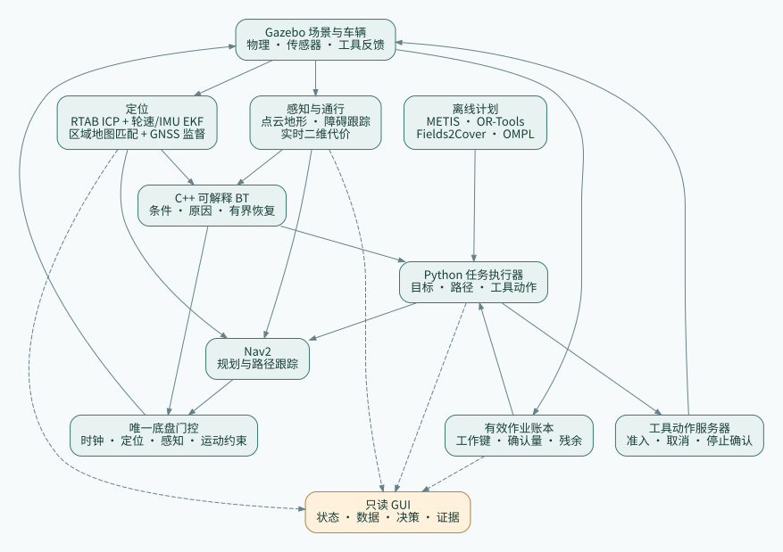
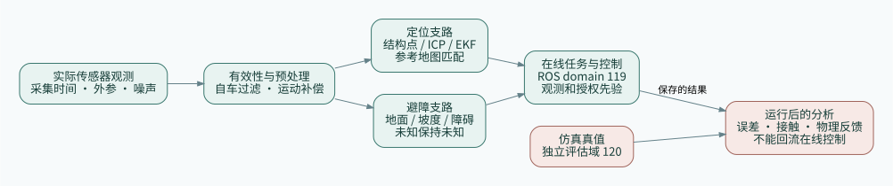
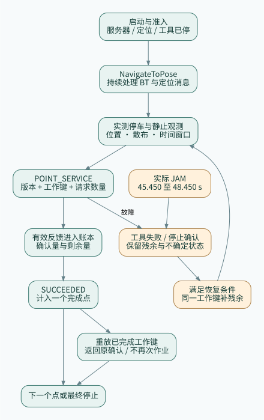
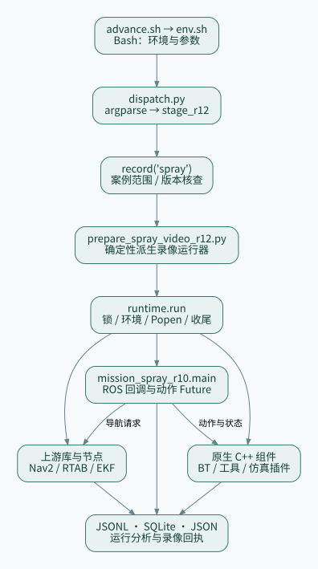

# 架构和数据如何贯穿一次任务

系统采用分层职责：Gazebo 产生物理状态和传感器观测，定位与感知解释观测，规划生成候选路径，BT 决定当前行为，任务执行器申请导航和工具动作，独立出口检查能否执行，最后由传感器和工具反馈闭合循环。

## 系统架构

图中的线表示数据或请求关系，不表示所有模块都处于同一个程序。ROS 节点是通信参与者，Linux 进程是操作系统调度的程序实例，两者不总是一对一。运行器另外拥有这些进程的启动与退出职责。

|层级|输入|输出|主要职责与代码入口|
|---|---|---|---|
|场景与车辆|地图、车辆尺寸、关节和动力学参数|带噪观测、运动、工具反馈|Gazebo；`VehicleDrive.cc`|
|传感器处理|点云、图像、IMU、轮速、GNSS|带时间和坐标信息的有效数据|误差注入、自车过滤、配对和运动补偿|
|定位|轮速/IMU、激光增量、参考云、GNSS|局部 odom、地图姿态、质量与锁存状态|RTAB ICP、EKF、`regional_r08.py`、全局监督|
|通行感知|当前点云与车辆几何|坡度、阶差、未知和危险区域、风险|地形处理与 Nav2 代价图|
|离线规划|区域边界、工作量、工具和车辆约束|三簇、点序、条带和连接段|METIS、OR-Tools、Fields2Cover、OMPL|
|决策与任务|任务进度、观测有效性、障碍、反馈|EXECUTE、WAIT、CANCEL、REPLAN、HUMAN 与动作请求|C++ BT；Python mission|
|导航与控制|目标或路径、实时位姿、代价图|候选线速度和角速度|Nav2 规划器、RPP 等控制器|
|最终执行|候选命令、时钟、定位、感知、BT、工具状态|获准的底盘/工具指令|唯一底盘门控、工具动作服务器|
|反馈与验收|实际工具反馈、位姿、事件；离线评估真值|确认量、残余、完成与失败判定|账本、分析器、独立评估域|

## 数据分支与时间

同一激光可以进入两个不同分支：定位分支保留对地图匹配有价值的结构，避障分支关注当前地形、低障碍与运动目标。它们可以有不同下采样规则，但必须保留真实的采集时刻和外参语义。把点云时间戳直接改成“现在”不能补偿车辆在延迟期间的运动。

`map` 表示任务和地图的全局参考；`odom` 表示局部连续运动参考；`base_link` 表示车辆基准。Dino 的基准与后轴相关，不能默认是车身中心。`map→odom` 允许通过定位修正更新，`odom→base_link` 应保持局部运动连续；每条变换有明确发布者，多个节点争发会造成不一致。

点喷运行器中的 ROS domain 119 用于在线算法，120 用于独立评估，121 用于原始观测处理入口。domain 是通信隔离配置，不是密码或操作系统安全边界。实际角色、桥接方向与环境可以在 [runtime][runtime] 的 `launch()` 和 `env` 设置中查到。

任务时限使用仿真时钟；进程退出和外部等待还需要单调现实时间。这样即使仿真停止推进，程序仍有机会有界结束。传感器采集时间、实际接收时间、GUI 文件更新时间也不能互相替代。

## 一次点喷的时序

导航返回成功后，任务还要确认车体和工具已停，收集静止定位样本，然后申请喷洒。工具服务器又独立检查准入和账本。任何一层返回“已发送”都不等于后面的物理动作已经完成。

图中实测三点案例发生了工具 JAM 和残余重试；局部精停移动是代码支持的条件分支，这次三点样本没有发出 `LOCAL_DOCK_GOAL`。样章中的微小位移演算属于另一个机制讲解，不归入该次运行的事件。

## 源码调用关系

`advance.sh` 加载环境，使用选定 Python 解释器启动 `dispatch.py`。分派器根据 `R12 record spray` 进入录像阶段；阶段代码检查派生关系，使用确定性生成的录像运行器。运行器启动多进程，任务脚本通过 ROS 动作接口与 Nav2 和工具服务器交互。[启动入口][entry]、[分派器][dispatch]、[录像阶段][stage12]

当前 C++ 工具服务器和部分监督器由基础源码与阶段适配确定性生成，运行配置会记录生成源和产物哈希。阅读原始 `action_server.cpp` 时，还应查看 `tool_build_r09.py`，才能解释当前二进制的差异。[工具基础实现][tool-server]、[当前派生器][tool-build]

## 决策为什么不能直接等同速度

BT 给出的“继续作业”表达任务意图。Nav2 根据位姿、路径和障碍计算候选速度。底盘出口再次检查数据是否新鲜、定位是否有效、路径方向和曲率是否合规，以及车体与工具当前状态。任何条件不满足，都可以把候选运动请求变成停止。

这种职责划分让错误更容易定位：BT 决定 EXECUTE 而车不动，可能是导航没有命令，也可能是出口拒绝；不能仅凭 BT 绿色状态断言控制失败。GUI 同时显示原始候选速度、门控后速度和拒绝原因，正是为了观察这层区别。[底盘出口][control]

<!-- generated fixed-revision references -->
[env]: https://github.com/caihao1B/ROS2_BT-/blob/9aff8337b7794f704c5556a973a5220e73f17808/optimization_v2/env.sh
[entry]: https://github.com/caihao1B/ROS2_BT-/blob/9aff8337b7794f704c5556a973a5220e73f17808/optimization_v2/three_tasks/advance.sh
[dispatch]: https://github.com/caihao1B/ROS2_BT-/blob/9aff8337b7794f704c5556a973a5220e73f17808/optimization_v2/ws/src/task_platform/scripts/dispatch.py
[common]: https://github.com/caihao1B/ROS2_BT-/blob/9aff8337b7794f704c5556a973a5220e73f17808/optimization_v2/ws/src/task_platform/scripts/common.py
[stage12]: https://github.com/caihao1B/ROS2_BT-/blob/9aff8337b7794f704c5556a973a5220e73f17808/optimization_v2/ws/src/task_platform/scripts/stage_r12.py
[derive]: https://github.com/caihao1B/ROS2_BT-/blob/9aff8337b7794f704c5556a973a5220e73f17808/optimization_v2/ws/src/task_platform/scripts/prepare_spray_video_r12.py
[runtime]: https://github.com/caihao1B/ROS2_BT-/blob/9aff8337b7794f704c5556a973a5220e73f17808/optimization_v2/ws/src/task_platform/scripts/runtime_spray_r10.py
[mission]: https://github.com/caihao1B/ROS2_BT-/blob/9aff8337b7794f704c5556a973a5220e73f17808/optimization_v2/ws/src/task_platform/scripts/mission_spray_r10.py
[control]: https://github.com/caihao1B/ROS2_BT-/blob/9aff8337b7794f704c5556a973a5220e73f17808/optimization_v2/ws/src/task_platform/scripts/control_spray_r10.py
[docking]: https://github.com/caihao1B/ROS2_BT-/blob/9aff8337b7794f704c5556a973a5220e73f17808/optimization_v2/ws/src/task_platform/scripts/docking_r10.py
[precision]: https://github.com/caihao1B/ROS2_BT-/blob/9aff8337b7794f704c5556a973a5220e73f17808/optimization_v2/ws/src/task_platform/r10_backend/precision_progress.hpp
[precision-builder]: https://github.com/caihao1B/ROS2_BT-/blob/9aff8337b7794f704c5556a973a5220e73f17808/optimization_v2/ws/src/task_platform/scripts/precision_supervisor_r10.py
[bt]: https://github.com/caihao1B/ROS2_BT-/blob/9aff8337b7794f704c5556a973a5220e73f17808/optimization_v2/ws/src/task_platform/r08_backend/policy.hpp
[tool-server]: https://github.com/caihao1B/ROS2_BT-/blob/9aff8337b7794f704c5556a973a5220e73f17808/optimization_v2/ws/src/tool_sim/src/action_server.cpp
[tool-build]: https://github.com/caihao1B/ROS2_BT-/blob/9aff8337b7794f704c5556a973a5220e73f17808/optimization_v2/ws/src/task_platform/scripts/tool_build_r09.py
[tool-action]: https://github.com/caihao1B/ROS2_BT-/blob/9aff8337b7794f704c5556a973a5220e73f17808/optimization_v2/ws/src/mission_interfaces/action/ToolTask.action
[cmake]: https://github.com/caihao1B/ROS2_BT-/blob/9aff8337b7794f704c5556a973a5220e73f17808/optimization_v2/ws/src/task_platform/CMakeLists.txt
[gui-page]: https://github.com/caihao1B/ROS2_BT-/blob/9aff8337b7794f704c5556a973a5220e73f17808/optimization_v2/three_tasks/monitor/index.html
[gui-data]: https://github.com/caihao1B/ROS2_BT-/blob/9aff8337b7794f704c5556a973a5220e73f17808/optimization_v2/three_tasks/monitor/data.py
[gui-observer]: https://github.com/caihao1B/ROS2_BT-/blob/9aff8337b7794f704c5556a973a5220e73f17808/optimization_v2/three_tasks/monitor/ros_observer.py
[point-result]: https://github.com/caihao1B/ROS2_BT-/blob/9aff8337b7794f704c5556a973a5220e73f17808/validation/R12/spray/mission_result.json
[point-events]: https://github.com/caihao1B/ROS2_BT-/blob/9aff8337b7794f704c5556a973a5220e73f17808/validation/R12/spray/mission_events.jsonl
[fault]: https://github.com/caihao1B/ROS2_BT-/blob/9aff8337b7794f704c5556a973a5220e73f17808/validation/R12/spray/fault_injection.json
[recording]: https://github.com/caihao1B/ROS2_BT-/blob/9aff8337b7794f704c5556a973a5220e73f17808/validation/R12/spray/recording_acceptance.json
[full-a1]: https://github.com/caihao1B/ROS2_BT-/blob/9aff8337b7794f704c5556a973a5220e73f17808/validation/R10/bounded_A1_result.json
[full-b1]: https://github.com/caihao1B/ROS2_BT-/blob/9aff8337b7794f704c5556a973a5220e73f17808/validation/R10/bounded_B1_result.json
[attempts]: https://github.com/caihao1B/ROS2_BT-/blob/9aff8337b7794f704c5556a973a5220e73f17808/validation/R10/repair_attempts.json
[historical-plan]: https://github.com/caihao1B/ROS2_BT-/blob/9aff8337b7794f704c5556a973a5220e73f17808/docs/optimization_v2/命令Prompt合集.md
[r-plan]: https://github.com/caihao1B/ROS2_BT-/blob/9aff8337b7794f704c5556a973a5220e73f17808/docs/three_tasks/实施步骤.md
[localization-doc]: https://github.com/caihao1B/ROS2_BT-/blob/9aff8337b7794f704c5556a973a5220e73f17808/docs/three_tasks/R05/TECHNICAL.md
[inspection-doc]: https://github.com/caihao1B/ROS2_BT-/blob/9aff8337b7794f704c5556a973a5220e73f17808/docs/three_tasks/R08/TECHNICAL.md
[mowing-doc]: https://github.com/caihao1B/ROS2_BT-/blob/9aff8337b7794f704c5556a973a5220e73f17808/docs/three_tasks/R09/TECHNICAL.md
[repair-doc]: https://github.com/caihao1B/ROS2_BT-/blob/9aff8337b7794f704c5556a973a5220e73f17808/docs/three_tasks/R10/GUI_AND_BOUNDED_REPAIR.md
[prediction]: https://github.com/caihao1B/ROS2_BT-/blob/9aff8337b7794f704c5556a973a5220e73f17808/docs/optimization_v2/S15/RESULTS.md
[cache]: https://github.com/caihao1B/ROS2_BT-/blob/9aff8337b7794f704c5556a973a5220e73f17808/docs/optimization_v2/S16/RESULTS.md
[resources-doc]: https://github.com/caihao1B/ROS2_BT-/blob/9aff8337b7794f704c5556a973a5220e73f17808/docs/three_tasks/R12/LOCAL_REPRODUCTION.md
[resources]: https://github.com/caihao1B/ROS2_BT-/blob/9aff8337b7794f704c5556a973a5220e73f17808/validation/GUI/local_resource_inventory.json
