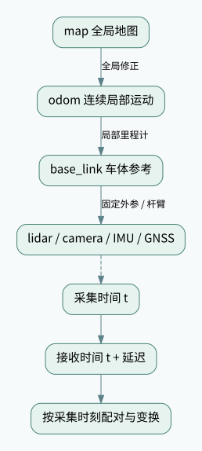

# 第 06 章 空间坐标与时间

机器人软件中的很多错误表现为路径偏移或突然转弯，实际原因却是坐标或时间不一致。一个位置数字只有同时说明“相对于谁、哪个时刻、什么单位”，才具有可执行意义。


<!-- l02-figure-frames -->



## map odom base_link 的职责

`base_link` 固定在车体上；`odom` 用于局部连续运动估计，允许长期漂移；`map` 用于全局地图一致性，定位修正可能使 map 到 odom 的变换改变。理想职责链是 `map → odom → base_link → sensor`。

对同一段 TF 应有唯一负责者。如果 ICP、EKF、全局管理器同时发布相同父子变换，消费者可能交替收到不同答案。项目把上游 publish_tf 与专用出口组合起来控制所有权；不能因为 RViz 暂时能显示，就认为重复 TF 没有问题。

定位修正应主要体现在 map→odom，局部控制依赖连续 odom。若全局地图匹配在停车时来回抖动，map 中目标距离也会变化，精停判断便可能失败。解决方向是检查修正一致性、观测与滤波，不是直接把导航容差变大。

## 二维刚体变换一步步计算

设车体坐标中的点为 p=(x,y)，地图中的车体平移为 t=(tx,ty)，航向为 θ。则地图点为 `R(θ)p+t`，其中 R 的两行为 `(cosθ,−sinθ)` 和 `(sinθ,cosθ)`。θ 使用弧度，位置使用米。

例如车体在地图 (2,3)，朝向 90°，车前方 1 m 的点在地图中是 (2,4)，而不是 (3,3)。从地图反变换回车体，需要先减平移再乘转置旋转：`Rᵀ(p_map−t)`。顺序颠倒会产生系统误差。

三维用旋转矩阵或四元数表达方向。ROS 四元数字段顺序为 x、y、z、w，很多数学库约定不同，读接口时必须核对。四元数应归一；全零不是合法旋转。只关心地面航向时也不能随意忽略坡面带来的 roll/pitch 与传感器高度变化。

## 航向差为何要 wrap

359° 与 1° 的最短差是 2°，直接相减得到 −358°。`atan2(sin Δ, cos Δ)` 把差归一到主值区间。这个技巧同时用于路径曲率、末端姿态比较和转向误差。使用弧度后 180° 对应 π，不要把 180 直接传给 sin。

## 本项目的地图平移

安全割草路径校验代码明确把导航坐标中的 `(x,y)` 转成世界坐标 `(x+28,y+14)` 后检查授权区域。这是固定版本的地图基准合同，不能在自己的地图里盲目套用。脚本中的常数一旦改变，会影响地图、GNSS 配准、路径及反馈几何，需要更新版本和复验。

GNSS 观测位置属于天线，不一定属于 base_link。若天线在车体前方 0.5 m，车辆转向时其地图位置也随航向改变。忽略杆臂可能造成随转弯变化的“定位误差”，即使 GNSS 本身没有突然漂移。

<!-- generated-production-start -->
## 固定生产代码逐段阅读

下面是固定提交中的原样节选。完整文件有离线行号页；片段可能省略上下文，不能单独当成可运行脚本。读完每段后，回到调用者确认它在当前任务中如何使用。

### recovery_mowing_r10.py 第 64 至 88 行

[离线带行号源码](../../baseline/l02_views/89c2a15110d3-recovery_mowing_r10.py.html#L64) · [固定 Git 提交](https://github.com/caihao1B/ROS2_BT-/blob/9aff8337b7794f704c5556a973a5220e73f17808/optimization_v2/ws/src/task_platform/scripts/recovery_mowing_r10.py#L64)

```python
def validate_candidate(points,start,goal,cfg,max_length=12.):
    from shapely.geometry import shape
    from footprint_r09 import body_polygon
    if len(points)<2 or any(not all(math.isfinite(v) for v in p) for p in points):return False,'MALFORMED_PATH'
    if math.dist(points[0][:2],start[:2])>.15 or yaw_error(points[0][2],start[2])>.10:return False,'START_DISCONTINUITY'
    if math.dist(points[-1][:2],goal[:2])>.05 or yaw_error(points[-1][2],goal[2])>.08:return False,'GOAL_MISMATCH'
    # The authoritative prior is in world coordinates; navigation is ENU.
    allowed=shape(cfg['allowed_prior']).buffer(-cfg['footprint_margin_m'])
    for p in points:
        if not allowed.covers(body_polygon(cfg['vehicle']['footprint'],p[0]+28,p[1]+14,p[2])):return False,'FOOTPRINT_OUTSIDE_PRIOR'
    length=0.
    for a,b in zip(points,points[1:]):
        ds=math.dist(a[:2],b[:2]);angle=yaw_error(a[2],b[2]);length+=ds
        if ds>.4:return False,'PATH_DISCONTINUITY'
        # Arc-length curvature from chord; identical cusp points may keep yaw.
        if ds<1e-5:
            if angle>1e-4:return False,'IN_PLACE_ROTATION'
        elif 2*math.sin(angle/2)/ds>cfg['vehicle']['steering']['max_curvature']+.005:return False,'CURVATURE_EXCEEDED'
        signed=math.atan2(math.sin(b[2]-a[2]),math.cos(b[2]-a[2]));steps=max(1,math.ceil(ds/.04),math.ceil(angle/.02))
        for j in range(1,steps):
            u=j/steps;p=[a[0]+u*(b[0]-a[0]),a[1]+u*(b[1]-a[1]),a[2]+u*signed]
            if not allowed.covers(body_polygon(cfg['vehicle']['footprint'],p[0]+28,p[1]+14,p[2])):return False,'SWEPT_FOOTPRINT_OUTSIDE_PRIOR'
    if not math.isfinite(max_length) or max_length<=0:return False,'INVALID_LENGTH_BOUND'
    if length>max_length:return False,'RECOVERY_TOO_LONG'
    return True,'PRIOR_AND_KINEMATICS_VALID_OBSERVED_RISK_STILL_REQUIRED'
```

先检查端点和姿态，再把导航点转换到 world 检查授权足迹。曲率用弦长和角差估计，插值补充两端之间扫掠。函数最后只声明先验与运动学通过，明确实时观测风险仍需另检。

<!-- generated-production-end -->

## 采集时间和接收时间

消息 header.stamp 应表示采集时刻。加入 0.2 s 传输延迟后，不能把 stamp 改成当前接收时间，否则接收者会误把旧数据当新数据。接收时间用于监视传输和计算耗时，采集时间用于配准、融合和时效性判断。

实际区域定位从历史里程计中选择最接近点云采集时刻的一项；超出配对差则拒绝。若使用最新里程计去解释较旧点云，车辆运动产生的位移可能被错误解释为地图修正。

`use_sim_time=true` 使支持 ROS 时钟的节点使用 `/clock`。它不会自动修改 Python 的 `time.time()` 或 `time.monotonic()`。仿真时间回退时，滤波历史、关联轨迹、序列号和超时状态要重新建立；继续沿用旧缓存容易出现负 dt 或跨会话重放。

## 读一条消息时的检查表

先看 stamp 与当前仿真时间之差；再看 frame_id 与预期坐标；再看位置/速度单位和有限性；再看 covariance、valid 和 reason。只有这几项一致，数值才值得进入后续算法。timestamp 新不代表估计有效；valid 真但很旧也不允许直接使用。

运行中可观察：

```bash
cd /home/ceihao/robot_project
source optimization_v2/env.sh
timeout 8s ros2 run tf2_ros tf2_echo map base_link
timeout 8s ros2 topic echo /clock --once
```

`tf2_echo` 持续显示变换，timeout 给观察设墙钟上限。刚启动时短暂等待 TF 不一定异常；长期缺失则沿父子链查负责节点，不能随便加一个静态 TF 把错误遮住。

## 离线计算与答案

执行 `python3 examples/l02/labs.py 06`，应得到地图点 (2,4)，采集年龄约 0.2 s，359° 的归一表示约 −0.01745 rad。浮点显示有微小尾差是二进制表示误差，比较时应使用合适容差。

<!-- generated-lab-start -->
### 本章练习核心代码与实际输出

[完整教学脚本](../../examples/l02/labs.py) · [本章完整输出](../../validation/L02/lab_06.json)

代码只使用 Python 标准库；合成输入与历史记录在输出 kind 中区分。公共 ROOT、read、wrap、connected 等辅助函数在完整脚本中定义。

```python
def lab06():
    """SE(2) composition; degrees converted to radians exactly once."""
    yaw = math.radians(90); p = (1., 0.); translation = (2., 3.)
    mapped = (translation[0]+math.cos(yaw)*p[0]-math.sin(yaw)*p[1],
              translation[1]+math.sin(yaw)*p[0]+math.cos(yaw)*p[1])
    age = 10.2 - 10.0
    assert math.dist(mapped,(2.,4.)) < 1e-12
    return dict(map_point_m=mapped, age_sim_s=age, wrapped_rad=wrap(math.radians(359)))
```

```text
{
  "chapter": "06",
  "passed": true,
  "result": {
    "map_point_m": [
      2.0,
      4.0
    ],
    "age_sim_s": 0.1999999999999993,
    "wrapped_rad": -0.017453292519943344
  }
}
```

本章例子可以在 Windows 使用 `py -3` 或在 Linux 使用 `python3` 重跑。它验证局部概念或读取历史证据，不对机器人全任务提供新通过结论。
<!-- generated-lab-end -->

问：为什么不能直接平均两个接近 ±π 的航向？答：普通算术平均可能得到 0，方向完全相反；要用角度展开或圆统计方法。

问：地图坐标跳了，是否证明车体瞬间移动？答：需要区分 map→odom 修正与 odom→base_link 连续运动，并检查独立观测。GUI 中轨迹跳变也可能由展示坐标变化引起。

练习：把一条点云、一条 odom 和一条 GNSS 的采集时间写在时间轴上，标出实际配对与最大允许差。没有时间合同的“融合”只是在把不同瞬间的数据放在一起。
