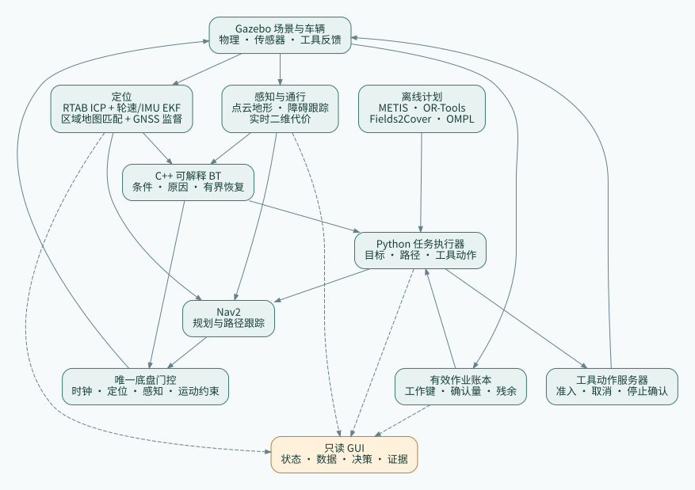

# 第 07 章 完整系统架构

系统架构需要同时回答两件事：数据从哪里来，以及谁有权让车或工具动作。只画“感知→规划→控制”三框图，会漏掉时效性、版本、取消、反馈和独立评估。下面沿一个服务点追踪这些责任。



## 从任务入口到多个运行进程

`advance.sh` 加载环境并把参数传给 `dispatch.py`；dispatch 选择阶段模块；R12 record 读取案例范围、检查 R09 和派生运行器；runtime 创建会话、生成配置、启动进程；mission 执行具体任务。文件名带 R08 的组件可能被 R10 继续复用，判断当前实现应看调用链和绑定，而不是只看名字。

任务运行目录记录 spec、mission、事件、定位状态、门控、工具账本、最终结果和录像。配置告诉你“要求怎样做”，状态告诉你“现在正在做什么”，证据告诉你“已经确认什么”。同名字段在这三层不能直接等价。

## 原始数据 在线观测 独立评估

当前工程使用 ROS domain 121 接收原始传感器输入，119 运行在线观测与任务，120 保存独立评估信息。传感器适配器是明确跨域的受控入口：它生成带噪声和延迟的观测，不把世界位姿当作在线定位答案。

domain 是通信隔离约定，不是面对恶意进程的完整安全边界。它的工程价值是减少无意读入真值，并使在线订阅范围可审查。独立评估可以在运行后计算误差，但不能把答案回流给任务来伪造定位效果。

## 定位和感知为什么分支

同一份 3D 点云可以服务不同目标。定位分支偏重稳定结构、几何可观测性和连续运动；感知分支保留低矮物体、地面变化和动态目标。若定位滤波为了减少地面点而删掉大量近地返回，不能直接把该点云当作完整低障碍感知输入。

相机有实际图像流与 GUI 展示，历史阶段有检测实验；当前每条任务并不都依赖成熟商用语义网络。教材将“接口存在”“候选实验完成”“当前默认启用”分开，避免把可视画面误写成完整视觉语义闭环。

## 决策 执行 门控三层关系

BT 读取定位、风险、任务、预算和进展，输出动作选择、原因码和速度上限。任务执行器把选择转成 Nav2 或工具 action，并维护异步句柄。底盘门控独立检查命令来源、时钟、定位、感知与物理限制，最后唯一出口才允许关节执行。

BT 选择 EXECUTE 不意味着电机立即有非零速度；Nav2 输出 Twist 也不意味着底盘已采用。反过来，门控零速不代表任务已取消，工具也可能仍处于停止确认中。GUI 同时展示这些层次正是为了学习这种差别。

## 工具和账本为何不在导航里完成

Nav2 关心可达路径与运动结果，它不理解喷洒剂量或有效割草面积。ToolTask 把工作请求变成工具状态机；实际模拟反馈决定有效量；SQLite 账本记录已确认及残余。导航到达、工具成功和整簇完成分别有自己的条件。

真实机械臂被留作后续独立项目，是合理的接口分离。当前抽象动作仍应包含目标身份、请求量、取消、错误、反馈和停止状态，未来机械臂才可以替换执行端而保留上层任务语义。

<!-- generated-production-start -->
## 固定生产代码逐段阅读

下面是固定提交中的原样节选。完整文件有离线行号页；片段可能省略上下文，不能单独当成可运行脚本。读完每段后，回到调用者确认它在当前任务中如何使用。

### adapter.py 第 23 至 41 行

[离线带行号源码](../../baseline/l02_views/14de986abb94-adapter.py.html#L23) · [固定 Git 提交](https://github.com/caihao1B/ROS2_BT-/blob/9aff8337b7794f704c5556a973a5220e73f17808/optimization_v2/ws/src/sensor_sim_adapter/scripts/adapter.py#L23)

```python
    def __init__(self,vehicle,out,seed,profile,streams='motion'):
        self.c=settings();self.vehicle=read(vehicle);self.out=out;out.mkdir(parents=True,exist_ok=True);self.log=(out/'generation.jsonl').open('w');self.t=0.;self.queue=[];self.bytes=0;self.highwater=0;self.seq=0;self.epoch=0;self.counts=Counter();self.drops=Counter();self.last={};self.profile=profile
        self.rng={k:np.random.default_rng(np.random.SeedSequence([seed,i])) for i,k in enumerate(['points','left','right','imu','wheel','gnss'])}
        self.gyro_bias=np.array(self.c['imu']['gyro_bias']);self.accel_bias=np.array(self.c['imu']['accel_bias']);self.gnss_bias=np.zeros(3);self.last_published={}
        self.raw_context=Context();self.online_context=Context();rclpy.init(context=self.raw_context,domain_id=121);rclpy.init(context=self.online_context,domain_id=119)
        self.raw=rclpy.create_node('s04_generator_raw_'+streams,context=self.raw_context);self.online=rclpy.create_node('s04_generator_output_'+streams,context=self.online_context)
        active={'points','left','right'} if streams=='vision' else {'imu','wheel','joints','gnss','quality'}
        self.pub={}
        for k,v in TYPES.items():
            if k not in active:continue
            qos=QoSProfile(depth=3 if k in ['left','right'] else 10,reliability=ReliabilityPolicy.BEST_EFFORT)
            self.pub[k]=self.online.create_publisher(v,'/s04/'+TOPICS[k],qos)
        self.raw.create_subscription(Clock,'/clock',self.clock,qos_profile_sensor_data)
        for key,typ,topic,callback in [('points',PointCloud2,'lidar/points',self.cloud),('left',Image,'left',lambda m:self.camera(m,'left')),('right',Image,'right',lambda m:self.camera(m,'right')),('imu',Imu,'imu',self.imu),('gnss',NavSatFix,'gnss',self.gnss),('wheel',String,'joints',self.wheel)]:
            if key in active:
                qos=QoSProfile(depth=3 if key in ['left','right'] else 20,reliability=ReliabilityPolicy.BEST_EFFORT)
                self.raw.create_subscription(typ,'/s04/raw/'+topic,callback,qos)
        self.executor=SingleThreadedExecutor(context=self.raw_context);self.executor.add_node(self.raw)
        (out/'ready').write_text('raw 121 -> observations 119')
```

此处选择 Adapter.__init__。两个 Context 分别进入原始域与在线域，发布器只输出明确观测，motion/vision 分支限制负载。它是受控跨域适配，不是任务节点随意读取真值。

### common.py 第 19 至 23 行

[离线带行号源码](../../baseline/l02_views/e9ad013f1962-common.py.html#L19) · [固定 Git 提交](https://github.com/caihao1B/ROS2_BT-/blob/9aff8337b7794f704c5556a973a5220e73f17808/optimization_v2/ws/src/task_platform/scripts/common.py#L19)

```python
def seal(stage,summary,files,sources,next_stage):
 out=APP/'results'/stage;out.mkdir(parents=True,exist_ok=True)
 artifacts={str(Path(p).relative_to(ROOT)):dict(path=str(Path(p).relative_to(ROOT)),sha256=sha(p)) for p in [*files,*sources] if Path(p).is_file()}
 result=dict(stage=stage,automated_status='PASS' if summary['passed'] else 'PARTIAL',summary=summary,artifacts=list(artifacts.values()),next_step=next_stage if summary['passed'] else None,formal_credit=False,original_S17='PARTIAL',original_S18='PARTIAL',created_utc=stamp())
 dump(out/'latest.json',result);return result
```

seal 保存 summary、来源文件与制品摘要。next_step 只在 summary 通过时提供；formal_credit 固定 false，原 S17/S18 PARTIAL 明确保留。写出回执是记录结论，不是替实验提供证据。

<!-- generated-production-end -->

## 版本合同贯穿所有层

地图、车体、传感器外参、规划、工具包络和执行代码共同决定结果。修改车宽会影响足迹、地头、代价图膨胀和传感器自车过滤；旧路径即使文件名相同，也可能不再可执行。项目的绑定检查以内容哈希识别变化，拒绝用旧 PASS 为新组合背书。

派生器会从旧源码确定性生成当前组件。学习时必须同时读源文件、派生修改和派生回执；仅对原始 `action_server.cpp` 的理解不足以代表 R09/R10 工具全部行为。生成代码是一种当前工程组织方式，未来可重构，但本教材先忠实解释固定实现。

## 一次 STOP 怎样传播

以感知数据过期为例：订阅监视发现年龄超限，监督上下文标记 stale/不健康，BT 选择 STOP 或 WAIT，任务申请取消活动动作，底盘门控立即拒绝非零候选，工具请求关闭，反馈确认停车，最后保存中止原因与残余。各层可能不同周期更新，所以需要状态机与超时，不能期望所有消息同一时刻变成 STOP。

某一层没有响应时，下面的独立门控仍应能停车；但“安全停车成功”也不能替代任务取消和账本收尾。这种分层让故障有多处阻断机会，同时需要清楚的所有权避免两个层争抢执行器。

## 离线练习与现场观察

执行 `python3 examples/l02/labs.py 07`。练习把版本、定位、感知、命令时效和工具状态视作五个条件，逐个置为假。只有全部满足的情况允许移动。这是理解“准入交集”的模型，不是生产门控的完整实现。

<!-- generated-lab-start -->
### 本章练习核心代码与实际输出

[完整教学脚本](../../examples/l02/labs.py) · [本章完整输出](../../validation/L02/lab_07.json)

代码只使用 Python 标准库；合成输入与历史记录在输出 kind 中区分。公共 ROOT、read、wrap、connected 等辅助函数在完整脚本中定义。

```python
def lab07():
    """Permission to move is an intersection of independent conditions."""
    inputs = dict(version=True, localization=True, perception=True,
                  command_fresh=True, tool_safe=True)
    rows = []
    for bad in [None,*inputs]:
        current=inputs.copy()
        if bad: current[bad]=False
        rows.append(dict(failed=bad,drive_allowed=all(current.values())))
    assert sum(r['drive_allowed'] for r in rows)==1
    return dict(kind='teaching gate, not production policy', cases=rows)
```

```text
{
  "chapter": "07",
  "passed": true,
  "result": {
    "kind": "teaching gate, not production policy",
    "cases": [
      {
        "failed": null,
        "drive_allowed": true
      },
      {
        "failed": "version",
        "drive_allowed": false
      },
      {
        "failed": "localization",
        "drive_allowed": false
      },
      {
        "failed": "perception",
        "drive_allowed": false
      },
      {
        "failed": "command_fresh",
        "drive_allowed": false
      },
      {
        "failed": "tool_safe",
        "drive_allowed": false
      }
    ]
  }
}
```

本章例子可以在 Windows 使用 `py -3` 或在 Linux 使用 `python3` 重跑。它验证局部概念或读取历史证据，不对机器人全任务提供新通过结论。
<!-- generated-lab-end -->

运行机器人时，先在 GUI 看当前任务、会话与版本，再看 BT action，再看 gate 候选/许可，最后看测得速度和工具反馈。若这几层不一致，记录同一时刻附近的证据，不要只截图最终画面。

## 自测与故障定位

问：BT 显示 EXECUTE，但车不动，先调控制器速度吗？答：先查命令是否产生、门控是否拒绝、车辆是否 armed、关节反馈是否有效。没有定位准入时增大速度参数没有意义。

问：离线地图里有障碍，实时感知是否没有价值？答：先验只覆盖授权的已知信息；临时障碍、动态目标、地形变化和传感器质量仍必须在线判断。

练习：画一条从“点云年龄过期”到“账本保留残余”的路径，每条箭头写出传递的字段或动作。能指出哪个模块有速度发布权、哪个只有观察权，才算理解架构。
