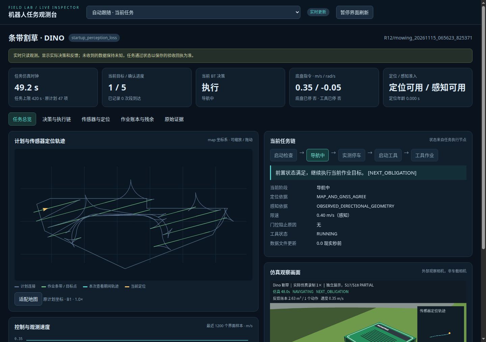

# 第 08 章 从启动命令到三点点喷闭环

本章通过一次真实三点点喷记录，说明一条 Linux 命令怎样启动多进程机器人系统，Python 怎样安排任务，C++ 怎样参与监督与工具执行，以及如何从反馈判断作业真的发生。你可以先在 Windows 阅读并分析附带证据，再切换到已经准备好的 Linux 机器复现。

案例来自固定基线中的 `spray_20261115_065207_245639`。它在 A1 的原 56 个点中选择前三个，经历一次真实模拟工具卡滞，最终完成 3 个点。它不代表完整 A1 已通过。本章也介绍代码支持的精停分支，但该次三点运行没有触发局部精停移动。

## 你要先认识的六个词

|词|在本章中的含义|不要混淆的对象|
|---|---|---|
|终端|输入命令并观察输出的窗口|窗口本身不是机器人程序|
|shell|解析命令的程序，本机主要使用 Bash|Python 是另一个解释器|
|进程|正在运行的程序实例，有自己的 PID 和环境|一个源码文件可以被多个进程执行|
|ROS 节点|通过 ROS 通信的参与者|节点与进程不一定一一对应|
|action 动作|可以发送目标、接收反馈/结果、申请取消的通信协议|发送成功不等于任务完成|
|账本|保存已确认作业量、残余和工作键的记录|计划经过的点数不是确认量|

## 先在 Windows 读懂结果

下载学习仓库并解压，直接打开 `index.html`。若已经安装 Python 3，在教材根目录打开 PowerShell，可以执行：

```powershell
py -3 examples\inspect_spray.py
```

`py` 是 Windows 的 Python 启动器，`-3` 请求 Python 3，最后是脚本路径。系统没有这个启动器时，先阅读[保存的输出](../../validation/inspect_spray.txt)和源码，不必为了阅读教材先安装机器人环境。

Linux 下同一个教学脚本使用：

```bash
cd /home/ceihao/self_learning
python3 examples/inspect_spray.py
```

脚本使用标准库 `pathlib` 和 `json`。它根据自己的文件位置找到教材证据，不连接 ROS、不启动 Gazebo，也不修改原工程。你应看到：选中 3 个点、完成 3 个点、原目标 56 个；工具失败记录 1 次、残余重试 1 次、幂等重放 1 次；最后车体和工具已停。

这里 JSON 是一个完整结构化文档，JSONL 是每一行一个 JSON 对象的事件流。结果文件适合回答“最终怎样”，事件文件适合回答“中间怎么走到这个结果”。

## 在 Linux 启动之前检查什么

下面的仿真命令适用于当前已经准备好的原工程，工作目录是 `/home/ceihao/robot_project`，而不是学习仓库。新机器要先准备[环境与资源](../../L01/09_environment.md)。

在终端一逐条执行：

```bash
cd /home/ceihao/robot_project
pwd
test -f optimization_v2/maps/frozen/map.db
echo $?
test -x optimization_v2/venvs/scene/bin/python
echo $?
bash optimization_v2/three_tasks/advance.sh R09 check
echo $?
```

|命令|逐项解释|应该怎样理解输出|
|---|---|---|
|`cd /home/ceihao/robot_project`|`cd` 是 Bash 内建命令，改变当前 shell 的工作目录|路径不存在就先解决目录问题|
|`pwd`|显示当前工作目录|应显示原机器人工程路径|
|`test -f 路径`|检查路径是否是普通文件；通常不输出文字|只能证明存在，不能证明地图内容正确|
|`test -x 路径`|检查文件是否具有执行访问权限|不能替代解释器依赖检查|
|`echo $?`|显示紧接上一条命令的退出码|0 通常表示该检查满足条件；应立即查看|
|`R09 check`|调用项目的 R09 回执和文件哈希检查|本机基线预期 PASS 和退出码 0|

`$?` 会被下一条命令覆盖，所以不要执行多条无关命令后再用它判断原检查。`test` 的 0/1 与项目脚本的 0/2 属于各自程序的约定，不能把所有非零码解释成同一种故障。

本章 `record spray` 的前置实际是 R09，因此 R10 当前 PARTIAL 不会单独禁止这个短案例。另一方面，R09 回执存在但绑定文件被改动，也会被前置检查拒绝。对应实现是 [common.require()][common] 和 [stage_r12.record()][stage12]。

## 两个终端分别做什么

终端一启动实时 GUI：

```bash
cd /home/ceihao/robot_project
bash optimization_v2/three_tasks/gui.sh
```

浏览器打开 `http://127.0.0.1:8088`。`127.0.0.1` 指正在使用浏览器的那台电脑本身；8088 是服务端口。GUI 终端会持续运行，这是服务器等待请求的正常状态。

终端二启动三点点喷：

```bash
cd /home/ceihao/robot_project
bash optimization_v2/three_tasks/advance.sh R12 record spray
```

这条命令会启动真实仿真、录制和分析，并生成新的运行目录。同一时刻只运行一个机器人案例。当前案例声明的上限是 300 仿真秒，运行器另设现实时间预算；保存的示例用了 92.786 仿真秒、约 242.68 秒任务墙钟，不能保证你每次都用相同时间。

正常情况下，GUI 自动跟随新运行。先观察启动定位与传感器准入，再看目标序号、导航、停车、工具工作和账本变化。定位尚未有效时等待是有条件的行为，不应通过手动发速度强行跳过。

## 把启动命令拆到每一层

`bash` 明确要求 Bash 执行脚本；脚本路径相对当前目录解析。`R12`、`record`、`spray` 是传给项目程序的三个字符串，分别表示录像交付阶段、录制动作、三点工具卡滞案例。它们不是 Linux 内置关键词。

下面是实际启动脚本的关键部分：[advance.sh][entry]

```bash
set -Eeuo pipefail
r_base="$(cd -- "$(dirname -- "${BASH_SOURCE[0]}")/.." && pwd -P)"
source "$r_base/env.sh"
export OMP_NUM_THREADS=1 OPENBLAS_NUM_THREADS=1
exec "$r_base/venvs/scene/bin/python" "$r_base/ws/src/task_platform/scripts/dispatch.py" "$@"
```

`set -Eeuo pipefail` 开启较严格的错误行为：`-e` 在适用的失败场景退出，`-u` 检查未设置变量，`pipefail` 让管道中的失败不被最后一项成功掩盖，`-E` 影响 ERR trap 的继承。Bash 的这些选项有语法上下文例外，不能把它们当成完整异常处理。实际任务仍需要自己的超时和 finally 收尾。

`${BASH_SOURCE[0]}` 是当前脚本路径；`dirname` 取其所在目录；`/..` 回到上一层；`$(...)` 是命令替换，把里面命令的输出放进字符串；`pwd -P` 取物理目录。双引号避免包含空格或中文的路径被拆成多个参数。`--` 用来结束选项解析，让后面的路径按路径处理。

`source` 在当前 shell 里执行环境脚本，因此后续程序能继承其中设置的环境变量。用 `bash env.sh` 会在另一个 shell 中执行，其环境修改通常不会传回当前 shell。该项目的 [env.sh][env] 会清理旧工作区环境，加载 Jazzy 和当前 overlay，并设置 domain 等变量。

`export` 将变量放入后续子进程环境。这里限制部分数值库线程数，减少线程竞争；它不是限制所有 ROS 节点只能使用一个 CPU 核。

`exec` 用指定 Python 程序替换当前 shell 进程，`"$@"` 按原参数边界转交所有参数。指定虚拟环境里的完整解释器路径，可以避免无意中使用另一个 Conda 或 Python 环境。

## Python 怎样找到这个任务

[dispatch.py][dispatch] 使用 `argparse` 读取 `stage`、`command` 和剩余参数。`R12` 决定导入 `stage_r12`，随后调用 `main('record', ['spray'])`。这是模块分派：把文本命令映射到相应 Python 模块和函数。

`stage_r12.py` 的 `CASES['spray']` 声明 `task='spray'`、`case='tool_jam'`、`point_limit=3`、`seconds=300`。因此本例不是“默认运行全部点”，也不是根据文件名猜出故障类型。[案例定义][stage12]

阶段程序还核对运行器来源和派生哈希。点喷录像采用 [prepare_spray_video_r12.py][derive] 从 R10 运行器确定性生成的版本，增加观测录制及对应传输配置。这里“派生”是脚本处理源码并记录来源，不是 Python 类继承。它让录像适配有独立版本，旧运行器仍可追溯。

`importlib` 把确定的运行器文件加载为 Python 模块；`runtime.run(...)` 才真正开始仿真。源文件和生成文件的哈希不一致时应重建并复验相关版本，不能删除核查语句来继续。

## 运行器为什么要启动很多进程

[runtime_spray_r10.py][runtime] 负责组成世界、记录 spec 和绑定、设置环境、启动 Gazebo、传感器处理、里程计、区域定位、感知、Nav2、工具、账本、任务以及独立评估进程。

`subprocess.Popen([...], env=..., cwd=..., stdout=..., start_new_session=True)` 表示启动一个子进程，指定环境、工作目录和日志输出。参数列表逐项传递给程序，通常不需要把它们拼成 shell 字符串。`start_new_session=True` 使运行器能按自己的会话管理退出。它只拥有自己启动的进程，不应通过系统范围的 killall 清理所有 ROS 程序。

运行器还建立 `session.lock`，防止两套任务同时占用同一实验环境。进程已启动与传感器已就绪是两件事，因此还要等待就绪文件、服务和定位条件。

输出目录包括：

|文件或目录|用途|
|---|---|
|`spec.json`|任务范围、时限、传感器和代码绑定|
|`mission.json`|本次计划和任务配置|
|`live.json`|最近任务状态，供 GUI 等读取|
|`mission_events.jsonl`|带仿真时间的动作和状态事件|
|`reference/live.json`|区域定位和 GNSS 监督状态|
|`control/gate.jsonl`|候选命令、允许/拒绝和实测停车|
|`ledger/ledger.sqlite`|反馈确认的作业账本|
|`mission_result.json`|任务完成量、失败与停止状态|
|`runtime.json`|进程退出、强制终止及运行资源检查|
|`recording_acceptance.json`|任务和录像的分项检查|
|`video/full.mp4`|这次运行的完整实际记录|

每次运行创建独立目录，旧证据不会因为你又运行一次就变成新版本证据。

## 任务状态机怎样等待真实消息

`mission_spray_r10.main()` 创建 ROS 节点和三个动作客户端：导航到点、沿路径运动、工具工作。它订阅 `/clock`、BT 指令、门控、定位、工具状态和反馈，将最近值保存到 `st` 字典中。[任务源码][mission]

字典适合把具名状态放在一起，例如 `st['phase']` 表示阶段，`st['loc']` 保存最近定位消息。订阅回调中的 `lambda m, k=key: ...` 使用默认参数固定当前 key，避免循环结束后所有回调都引用最后一个 key。

等待不是简单睡够若干秒。实际 `wait()` 反复调用 `tick()`，`tick()` 内执行 `rclpy.spin_once()`，让消息回调继续更新状态，同时检查停止请求和时限。若等待期间不处理回调，程序可能永远等不到已经到达通信队列的结果。

`Future` 表示一个将来完成的异步结果。`future.done()` 检查结果是否到达；`future.result()` 读取已经返回的内容。导航目标被接受、导航最终成功、实测停止、工具准入，是不同的状态，需要分别检查。

局部 helper 使用 `nonlocal active_nav` 时，表示要更新外围 `main()` 里的活动导航句柄，而不是新建一个同名局部变量。这个句柄让异常收尾知道是否还需要取消动作。

## 从导航到有效喷洒

执行一个点的主逻辑可以概括如下。这是阅读用伪代码，实际源码还包含重验证、超时与拒绝处理：

```text
等待导航和工具服务器就绪，等待可信定位
对选中的每个目标点：
    申请 NavigateToPose，持续读取 BT 和定位状态
    导航结束后确认实测停车
    收集静止定位窗口；必要时申请有界局部精停
    申请 POINT_SERVICE，继续响应取消和停止
    读取工具结果与账本
    若失败且停止没有不确定性，等待恢复并按同一工作键补残余
    只有 SUCCEEDED 才把该点加入完成列表
最后关闭工具、确认停车、保存结果
```

点任务一般使用 `NavigateToPose`，因为目标是一个服务位姿，Nav2 可规划接近路径。需要短距离精停时，程序先构造并检查局部路径，再使用 `FollowPath`。两种动作承担不同职责，不是简单二选一。

### 静止定位窗口为什么比一个点可靠

实际 `stable_dock()` 至少要求 20 个样本、时间跨度 1.8 秒、最大采样间隔 0.15 秒；中位位置到目标不超过 0.035 m，最新位置不超过 0.045 m，位置散布 p95 不超过 0.015 m。[精停判据][docking]

中位位置用于降低个别样本影响；最新位置约束避免“过去平均接近、现在已经离开”；散布约束要求观测在停止期间稳定。样本数量、时间跨度和最大间隔共同防止用短时间重复值假装长时间稳定。

这次第二个点的最新距离约 0.03632 m，大于中位位置门限 0.035 m，但仍小于最新位置门限 0.045 m；中位距离约 0.03254 m，所以该次窗口可以通过。不同字段对应不同判据，不能只挑一个数字比较。

### 底盘门控为什么仍要独立检查

Python mission 申请动作，不直接发布最终底盘执行命令。Nav2 输出候选速度，[control_spray_r10.py][control] 检查消息新鲜度、定位、地形、BT、工具与运动约束，再发布 `/s03/actuator/request`。

当 BT 要求 EXECUTE 但感知过期，门控仍可以停止。GUI 中“当前决策”“原始速度”“门控后速度”“停止原因”要一起看。工具服务器也独立控制 `/s10/tool/command`，导航线程无权把账本完成量直接加一。

## C++ 核心逻辑的一个小例子

以实际生产头文件 [precision_progress.hpp][precision] 为例，它把已验证精停动作的进展尺度与预计移动距离联系起来。

```cpp
inline double progressDelta(const nlohmann::json& cfg,
                            const nlohmann::json& e) {
  const double coarse = cfg.at("progress_delta_m").get<double>();
  if (!cfg.contains("precision_progress_policy") ||
      e.value("motion_scope", std::string()) != "VALIDATED_LOCAL_DOCKING" ||
      !e.contains("expected_translation_m") ||
      !e["expected_translation_m"].is_number()) return coarse;
  const double distance = e["expected_translation_m"].get<double>();
  if (!std::isfinite(distance) || distance <= .008 || distance > .15)
    return coarse;
  return std::min(coarse, std::max(.005, .25 * distance));
}
```

上面为同一函数的换行排版，逻辑与冻结头文件一致。`double` 表示浮点数；`const ...&` 通过只读引用接收 JSON 对象；`.at()` 读取必须存在的键，缺键会抛异常；`.value()` 可在键不存在时返回给定默认值；`.get<double>()` 把 JSON 数值转成 C++ double。默认值不会自动修复已有字段的错误类型。

`inline` 允许这种函数定义放在头文件中被多个翻译单元使用，不保证编译器一定把所有调用展开。外层 `namespace r10` 用于组织名字；`#pragma once` 避免同一头文件在一个编译单元里被重复包含。

原粗尺度为 0.10 m。对于已经通过验证、预计平移 0.036 m 的精停：

```text
0.25 × 0.036 m = 0.009 m
max(0.005 m, 0.009 m) = 0.009 m
min(0.10 m, 0.009 m) = 0.009 m
```

因此进展要求是 9 mm。动作范围不匹配、距离非有限或越界时返回原粗尺度。这不是把所有导航都改成毫米级判据，也不会改变工具位置准入；10 秒无进展超时仍由 BT 其他部分控制。[BT 派生][precision-builder]、[BT 判据][bt]

要理解 C++ 的编译过程，可在学习目录执行：

```bash
cd /home/ceihao/self_learning
mkdir -p build
g++ -std=c++17 -Wall -Wextra -pedantic examples/precision_demo.cpp -o build/precision_demo
./build/precision_demo
```

`mkdir -p` 创建目录并允许其已存在；`g++` 是 C++ 编译器驱动；`-std=c++17` 选择语言标准；告警选项帮助发现可疑写法；`-o` 指定输出可执行文件。`./` 表示执行当前目录下的文件，Linux 一般不会默认在当前目录搜索任意命令。

本例直接包含教材冻结的生产头文件并使用本机已有 nlohmann/json 头文件；没有启动 ROS。它显示普通动作 0.100 m、合格精停 0.009 m、越界动作回退 0.100 m。该函数调用不能替代真实运动或完整 BT 测试。[教学程序](../../examples/precision_demo.cpp)

## 工具服务器与账本怎样配合

`tool_goal()` 创建 `ToolTask.Goal`：操作为 `POINT_SERVICE`，包含任务标识、地图/计划/工具版本、目标、请求数量和超时。幂等键由计划版本和点 ID 组成，表示“这一次计划里的这个工作”，而不是每次请求都换一个新工作。[动作协议][tool-action]

C++ 工具服务器使用动作接口接收请求，向账本保留工作键，确认准入后发工具命令，持续检查新鲜反馈，达到确认量或遇到故障时开始停止。请求停止后还要检查物理反馈，若无法确认则保留 uncertainty，不能自动当作可安全补作。[基础工具实现][tool-server]和[阶段派生][tool-build]

SQLite 账本保存确认量和事务状态。它只接纳符合时间、位姿、工具和任务条件的反馈，所以原始计量器增加值与有效确认剂量不必完全相同。这里的“剂量单位”是仿真定义的计量单位，没有依据把它写成毫升。

幂等性的含义是：重复提交同一个已完成工作键，返回已经确认的结果，而不是再次喷洒。部分失败则保留残余和停止状态，只有满足恢复条件时才补作。这与简单“失败就重新完整喷一次”有本质的计量差异。

## 用实际时间线检查上面的解释

下面时间全部是仿真秒，来自[任务事件][point-events]和[故障注入记录][fault]。

|仿真秒|实际事件|怎样理解|
|---|---|---|
|8.002|COARSE_PUBLIC_PLAN_HINT|发送公开计划附近的粗初值，仍需观测匹配|
|19.206|第一个 NAV_GOAL|导航生命周期已确认活动，发出第一个点目标|
|22.500|第一个 DOCKING_SETTLED_CHECK|61 样本、1.8 秒窗口，静止检查通过|
|26.574|第一个 TOOL_RESULT|确认 3.044 单位，点状态 SUCCEEDED|
|26.622|幂等重放|返回已确认结果；计量器前后都是 3.2337|
|45.450|注入 JAM，持续到 48.450|声明的模拟执行器故障，没有修改车辆位姿|
|46.392|第二点工具结果 FAILED / TOOL_HEALTH|有效确认 0，残余 3.0，停止无不确定标志|
|46.410|RESIDUAL_RETRY|开始等待恢复、重新确认停车与定位条件|
|55.866|第二点工具成功|确认 3.074 单位|
|90.758|第三点工具成功|确认 3.052 单位|
|90.780|SUBSET_FINISHED|选中 3、完成 3、原目标 56|
|92.786|FINAL_TOOL_STOP|工具最终 STOPPED|

第一次 NAV_GOAL 与 NAV_SUCCESS 在这次记录里很接近，不代表普遍的导航速度；场景起点与第一个目标接近时，导航可能很快结束。判断是否真的完成工作仍要看后续静止观察、工具和反馈。

第二点的第一次原始计量器从 3.2337 增加到 3.3613，但有效确认量为 0。这提醒你分别阅读模拟计量、有效作业条件和账本，不应把任意计量增加都算成有效喷洒。

## 怎样在 GUI 里对应检查



这张截图来自同一项目的割草启动故障运行，用于说明页面布局；本章点喷应在任务下拉框中选择相应点喷运行，不能把截图当作点喷记录。

|GUI 页面|查看内容|要回答的问题|
|---|---|---|
|任务总览|任务类型、阶段、目标索引、轨迹、原任务数量|现在在哪一步？当前目标序号是不是完成数？|
|决策与执行链|BT 动作、原因、资格与事件|为什么等待或取消？后续是否确认停止？|
|传感器与定位|频率、时间年龄、定位质量、相机和点云|数据更新了吗？更新的数据是否也有效？|
|作业账本与残余|工作键、确认量、残余、不确定状态|失败之后保留了什么？是否重复作业？|
|原始证据|实际 JSON 字段和版本|页面显示能否追溯到数据？|

历史模式显示保存的末次状态与事件窗口，不能逐帧重建没有保存的原始传感器。实时传感器预览只属于匹配的活动运行；空白点云不表示前方没有障碍。暂停界面刷新只冻结显示，不暂停机器人。[GUI 数据聚合][gui-data]、[只读订阅][gui-observer]

## 用 ROS 命令看实际数据

任务运行期间，在第三个 Linux 终端执行：

```bash
cd /home/ceihao/robot_project
source optimization_v2/env.sh
ros2 node list
ros2 topic list
timeout 8s ros2 topic echo /s05/odometry --once
timeout 8s ros2 topic echo /r06/directive --once
timeout 8s ros2 topic echo /r07/gate --once
```

新终端不会自动继承另一个终端执行过的 source，因此要加载环境。`ros2 node list` 查询可发现节点；`ros2 topic list` 查询话题。`echo --once` 接收一次消息后退出；`timeout 8s` 给这个观察命令加现实时间上限，超时只停止观察命令，不表示要求机器人停车。

域、QoS 或发布状态不匹配都可能导致看不到消息；没有消息不能立即证明传感器损坏。先查看任务是否运行、当前 domain 和节点状态，再检查实际话题类型与 QoS。

本章完整新任务不会在编写资料时再次启动；上面是当前基线已存在的人工观察路径。重新运行得到新的时间和结果应分别保存。

## 如何停止和读取结果

需要中断时，在**任务终端**按 Ctrl+C，然后等待任务取消、车体与工具停止、结果保存和进程退出。关闭 GUI 窗口不会停止任务；只关闭任务窗口也不利于观察收尾。停止是否成功以反馈和退出记录判断。

查看最近三点录制回执可执行：

```bash
cd /home/ceihao/robot_project
python3 -m json.tool optimization_v2/three_tasks/results/R12/spray_latest.json
```

`python3 -m json.tool` 使用标准库把 JSON 格式化输出，不修改该文件。回执的 `path` 指向这一次运行目录；`spray_latest.json` 是 JSON 指针文件，不是 Linux 软链接。重新录制后它会指向新目录，教材案例则固定保存在学习仓库中。

还要看 `mission_result.json` 的完成列表、`runtime.json` 的退出情况、`recording_acceptance.json` 的任务与录像分项。有些受控终止路径进程可以正常退出，但任务仍未完成；进程退出码不能单独证明完成全部作业。

在当前基线运行 `bash optimization_v2/three_tasks/advance.sh R12 check` 会因为上游 R10/R11 PARTIAL 返回 2。这不是让你重装 ROS 的指示，也不否认三点短演示通过。应该阅读 pending 和 changed：前者表示阶段缺项，后者表示文件与封存证据是否改变。

## 三个容易误判的场景

第一，机器人停在目标附近但不喷洒。先看实测停止、定位窗口、BT 和工具准入；距离肉眼很近不等于满足所有条件。

第二，工具故障后再次工作。检查工作键、停止不确定标志和残余，不应只凭“又喷了一次”判断重复计量。

第三，视频里任务完整结束。确认所选范围：三点演示的完整执行不等于 56 点全部完成，录像时间线完整也不保证任务指标全部通过。

## 自测与答案

1. 为什么 `source env.sh` 与 `bash env.sh` 的效果不同？前者修改当前 shell 环境，后者的环境通常只存在于子 shell 及其后代。
2. 看到 NAV_SUCCESS 能否直接把点记为完成？不能；还要停车、静止观察、工具和账本确认。
3. 本例为什么只完成三个点？`CASES['spray']` 明确设置 `point_limit=3`，原 56 点保留。
4. 为什么重放结果 confirmed 仍为 3.044，却没有再次喷洒？它返回同一工作键的既有确认，计量器前后不变。
5. 第二点第一次计量器增加了，为什么 confirmed 为 0？有效作业还有反馈健康、时间和任务准入等条件，原始累计量不直接等于有效剂量。
6. 精停公式算出 9 mm，能否用于所有导航？不能；范围与距离校验通过才使用，粗导航和其他门限保持原规则。
7. 本例是否验证了局部精停移动？没有，事件中没有 LOCAL_DOCK_GOAL；相关代码与其他证据另行说明。
8. 点喷短演示通过后，R12 是否必定 PASS？不必；阶段还要求上游完整任务等条件。

完成练习后，建议回到[架构图](../../L01/02_architecture.md)，把每个新认识的函数放回其层级，再进入定位、感知和规划章节。


<!-- generated-production-start -->
## 固定生产代码逐段阅读

下面是固定提交中的原样节选。完整文件有离线行号页；片段可能省略上下文，不能单独当成可运行脚本。读完每段后，回到调用者确认它在当前任务中如何使用。

### precision_progress.hpp 第 1 至 17 行

[离线带行号源码](../../baseline/l02_views/3b34eb3bcafc-precision_progress.hpp.html#L1) · [固定 Git 提交](https://github.com/caihao1B/ROS2_BT-/blob/9aff8337b7794f704c5556a973a5220e73f17808/optimization_v2/ws/src/task_platform/r10_backend/precision_progress.hpp#L1)

```cpp
#pragma once
#include <nlohmann/json.hpp>
#include <algorithm>
#include <cmath>
namespace r10 {
// Match progress scale to an explicitly validated, bounded precision motion.
// The 10 s timeout, emergency priority and original work admission stay intact.
inline double progressDelta(const nlohmann::json& cfg,const nlohmann::json& e) {
  const double coarse=cfg.at("progress_delta_m").get<double>();
  if (!cfg.contains("precision_progress_policy") ||
      e.value("motion_scope",std::string())!="VALIDATED_LOCAL_DOCKING" ||
      !e.contains("expected_translation_m") || !e["expected_translation_m"].is_number()) return coarse;
  const double distance=e["expected_translation_m"].get<double>();
  if (!std::isfinite(distance) || distance<=.008 || distance>.15) return coarse;
  return std::min(coarse,std::max(.005,.25*distance));
}
}
```

与样章已有解读一致，保留一个独立可编译的真实判据入口。这个函数只返回距离尺度，不能独自证明超时、碰撞或工具反馈正确。

<!-- generated-production-end -->

<!-- generated-lab-start -->
### 本章练习核心代码与实际输出

[完整教学脚本](../../examples/l02/labs.py) · [本章完整输出](../../validation/L02/lab_08.json)

代码只使用 Python 标准库；合成输入与历史记录在输出 kind 中区分。公共 ROOT、read、wrap、connected 等辅助函数在完整脚本中定义。

```python
def lab08():
    """Execute the existing L01 real-evidence walkthrough."""
    r=subprocess.run([sys.executable,str(ROOT/'examples/inspect_spray.py')],
                     capture_output=True,text=True,timeout=10)
    assert r.returncode==0, r.stderr
    return dict(kind='historical evidence',output=r.stdout.strip())
```

```text
{
  "chapter": "08",
  "passed": true,
  "result": {
    "kind": "historical evidence",
    "output": "selected=3 completed=3 original=56\ntool_failed_attempts=1 residual_retries=1 idempotent_replays=1\nreplay_meter_before=3.2337 after=3.2337\nlocal_dock_goals=0\nstopped=True tool_stopped=True\nsim_seconds=92.786 task_wall_seconds=242.678\ntask_passed=True video_valid=True\nScope: historical selected three-point case; original A1 has 56 obligations."
  }
}
```

本章例子可以在 Windows 使用 `py -3` 或在 Linux 使用 `python3` 重跑。它验证局部概念或读取历史证据，不对机器人全任务提供新通过结论。
<!-- generated-lab-end -->

<!-- generated fixed-revision references -->
[env]: https://github.com/caihao1B/ROS2_BT-/blob/9aff8337b7794f704c5556a973a5220e73f17808/optimization_v2/env.sh
[entry]: https://github.com/caihao1B/ROS2_BT-/blob/9aff8337b7794f704c5556a973a5220e73f17808/optimization_v2/three_tasks/advance.sh
[dispatch]: https://github.com/caihao1B/ROS2_BT-/blob/9aff8337b7794f704c5556a973a5220e73f17808/optimization_v2/ws/src/task_platform/scripts/dispatch.py
[common]: https://github.com/caihao1B/ROS2_BT-/blob/9aff8337b7794f704c5556a973a5220e73f17808/optimization_v2/ws/src/task_platform/scripts/common.py
[stage12]: https://github.com/caihao1B/ROS2_BT-/blob/9aff8337b7794f704c5556a973a5220e73f17808/optimization_v2/ws/src/task_platform/scripts/stage_r12.py
[derive]: https://github.com/caihao1B/ROS2_BT-/blob/9aff8337b7794f704c5556a973a5220e73f17808/optimization_v2/ws/src/task_platform/scripts/prepare_spray_video_r12.py
[runtime]: https://github.com/caihao1B/ROS2_BT-/blob/9aff8337b7794f704c5556a973a5220e73f17808/optimization_v2/ws/src/task_platform/scripts/runtime_spray_r10.py
[mission]: https://github.com/caihao1B/ROS2_BT-/blob/9aff8337b7794f704c5556a973a5220e73f17808/optimization_v2/ws/src/task_platform/scripts/mission_spray_r10.py
[control]: https://github.com/caihao1B/ROS2_BT-/blob/9aff8337b7794f704c5556a973a5220e73f17808/optimization_v2/ws/src/task_platform/scripts/control_spray_r10.py
[docking]: https://github.com/caihao1B/ROS2_BT-/blob/9aff8337b7794f704c5556a973a5220e73f17808/optimization_v2/ws/src/task_platform/scripts/docking_r10.py
[precision]: https://github.com/caihao1B/ROS2_BT-/blob/9aff8337b7794f704c5556a973a5220e73f17808/optimization_v2/ws/src/task_platform/r10_backend/precision_progress.hpp
[precision-builder]: https://github.com/caihao1B/ROS2_BT-/blob/9aff8337b7794f704c5556a973a5220e73f17808/optimization_v2/ws/src/task_platform/scripts/precision_supervisor_r10.py
[bt]: https://github.com/caihao1B/ROS2_BT-/blob/9aff8337b7794f704c5556a973a5220e73f17808/optimization_v2/ws/src/task_platform/r08_backend/policy.hpp
[tool-server]: https://github.com/caihao1B/ROS2_BT-/blob/9aff8337b7794f704c5556a973a5220e73f17808/optimization_v2/ws/src/tool_sim/src/action_server.cpp
[tool-build]: https://github.com/caihao1B/ROS2_BT-/blob/9aff8337b7794f704c5556a973a5220e73f17808/optimization_v2/ws/src/task_platform/scripts/tool_build_r09.py
[tool-action]: https://github.com/caihao1B/ROS2_BT-/blob/9aff8337b7794f704c5556a973a5220e73f17808/optimization_v2/ws/src/mission_interfaces/action/ToolTask.action
[cmake]: https://github.com/caihao1B/ROS2_BT-/blob/9aff8337b7794f704c5556a973a5220e73f17808/optimization_v2/ws/src/task_platform/CMakeLists.txt
[gui-page]: https://github.com/caihao1B/ROS2_BT-/blob/9aff8337b7794f704c5556a973a5220e73f17808/optimization_v2/three_tasks/monitor/index.html
[gui-data]: https://github.com/caihao1B/ROS2_BT-/blob/9aff8337b7794f704c5556a973a5220e73f17808/optimization_v2/three_tasks/monitor/data.py
[gui-observer]: https://github.com/caihao1B/ROS2_BT-/blob/9aff8337b7794f704c5556a973a5220e73f17808/optimization_v2/three_tasks/monitor/ros_observer.py
[point-result]: https://github.com/caihao1B/ROS2_BT-/blob/9aff8337b7794f704c5556a973a5220e73f17808/validation/R12/spray/mission_result.json
[point-events]: https://github.com/caihao1B/ROS2_BT-/blob/9aff8337b7794f704c5556a973a5220e73f17808/validation/R12/spray/mission_events.jsonl
[fault]: https://github.com/caihao1B/ROS2_BT-/blob/9aff8337b7794f704c5556a973a5220e73f17808/validation/R12/spray/fault_injection.json
[recording]: https://github.com/caihao1B/ROS2_BT-/blob/9aff8337b7794f704c5556a973a5220e73f17808/validation/R12/spray/recording_acceptance.json
[full-a1]: https://github.com/caihao1B/ROS2_BT-/blob/9aff8337b7794f704c5556a973a5220e73f17808/validation/R10/bounded_A1_result.json
[full-b1]: https://github.com/caihao1B/ROS2_BT-/blob/9aff8337b7794f704c5556a973a5220e73f17808/validation/R10/bounded_B1_result.json
[attempts]: https://github.com/caihao1B/ROS2_BT-/blob/9aff8337b7794f704c5556a973a5220e73f17808/validation/R10/repair_attempts.json
[historical-plan]: https://github.com/caihao1B/ROS2_BT-/blob/9aff8337b7794f704c5556a973a5220e73f17808/docs/optimization_v2/命令Prompt合集.md
[r-plan]: https://github.com/caihao1B/ROS2_BT-/blob/9aff8337b7794f704c5556a973a5220e73f17808/docs/three_tasks/实施步骤.md
[localization-doc]: https://github.com/caihao1B/ROS2_BT-/blob/9aff8337b7794f704c5556a973a5220e73f17808/docs/three_tasks/R05/TECHNICAL.md
[inspection-doc]: https://github.com/caihao1B/ROS2_BT-/blob/9aff8337b7794f704c5556a973a5220e73f17808/docs/three_tasks/R08/TECHNICAL.md
[mowing-doc]: https://github.com/caihao1B/ROS2_BT-/blob/9aff8337b7794f704c5556a973a5220e73f17808/docs/three_tasks/R09/TECHNICAL.md
[repair-doc]: https://github.com/caihao1B/ROS2_BT-/blob/9aff8337b7794f704c5556a973a5220e73f17808/docs/three_tasks/R10/GUI_AND_BOUNDED_REPAIR.md
[prediction]: https://github.com/caihao1B/ROS2_BT-/blob/9aff8337b7794f704c5556a973a5220e73f17808/docs/optimization_v2/S15/RESULTS.md
[cache]: https://github.com/caihao1B/ROS2_BT-/blob/9aff8337b7794f704c5556a973a5220e73f17808/docs/optimization_v2/S16/RESULTS.md
[resources-doc]: https://github.com/caihao1B/ROS2_BT-/blob/9aff8337b7794f704c5556a973a5220e73f17808/docs/three_tasks/R12/LOCAL_REPRODUCTION.md
[resources]: https://github.com/caihao1B/ROS2_BT-/blob/9aff8337b7794f704c5556a973a5220e73f17808/validation/GUI/local_resource_inventory.json
