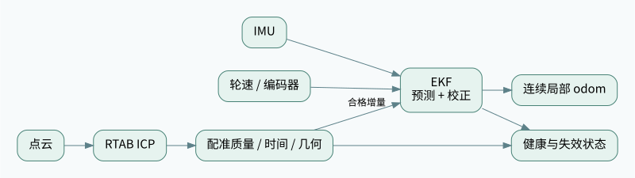

# 第 12 章 轮速 IMU 与激光局部里程计

局部里程计回答“刚才到现在移动了多少”。轮速更新快但会滑，IMU 能捕捉转动但有偏置，激光能利用环境结构但会退化。融合的目标是利用互补信息，并在某项不可信时降低或拒绝其影响，而不是把所有位置简单平均。


<!-- l02-figure-fusion -->



## 轮速积分

平面模型以状态 `(x,y,θ)` 表示运动。时间间隔 dt 内近似 `x+=v cosθ dt`、`y+=v sinθ dt`、`θ+=ωdt`。曲线运动可使用中点航向或更精确积分。即使每步误差很小，偏置会随时间积累，所以局部 odom 不应承担永久全局定位职责。

若角速度偏置为 0.002 rad/s，100 s 就累计约 0.2 rad，约 11.5°。这不是说当前系统必然漂移这么多，而是说明未经校正的偏置会怎样积累。白噪声均值接近零也不能消除固定偏置。

## ICP 在做什么

迭代最近点 ICP 先根据初值把当前点云移到参考附近，再建立对应点，优化旋转和平移，重复直到收敛或达到次数。点到平面目标可写成各对应点的 `nᵀ(Rp+t−q)` 平方和，其中 n 为参考表面法向。

长直墙或平地对某些方向约束弱，目标函数可能在某个方向很平。点数很多不等于约束充分：十万个共面点也可能缺少横向定位能力。项目检查法向分布特征值和 RTAB 的配准质量，尽量拒绝退化数据。

当前 RTAB 原生 ICP 作为局部里程计，输出还经过 `icp_gate.py`。它按采集时间配对 Odometry 与 OdomInfo，检查 lost、inlier ratio、协方差、几何质量与运动跳变，再从有界历史窗口得到速度增量。这样避免把已有绝对位姿重复当作独立信息反馈进同一个滤波环。

## EKF 的预测和校正

扩展卡尔曼滤波 EKF 保存状态估计 x 和协方差 P。预测用运动模型 f：`x⁻=f(x,u,dt)`，`P⁻=FPFᵀ+Q`。观测 z 到来后，创新 `r=z−h(x⁻)`，创新协方差 `S=HP⁻Hᵀ+R`，增益 `K=P⁻HᵀS⁻¹`，更新 `x=x⁻+Kr`。F、H 是局部线性化矩阵；Q 描述模型不确定性，R 描述测量不确定性。

不用一开始就熟练推导矩阵。先看一维例子：预测 1.0 m，预测方差 0.04 m²，测量 1.2 m，测量方差 0.01 m²，则 K=0.8，更新到 1.16 m。测量更可信，结果向它靠近，但不是完全替代预测。

协方差是方差，不是标准差。0.02 m 的 sigma 对应 0.0004 m²。把 sigma 直接放进方差字段会改变权重；把未知误差设成零则会制造不合理自信。

## 当前配置怎样选择输入

`local_estimator.yaml` 的布尔数组按 robot_localization 状态排列，分别选择位置、姿态、线速度、角速度与加速度分量。基础配置使用轮速线速度、IMU 部分姿态/角速度和 ICP 增量；但实际三任务场景会派生外参与预处理，因此阅读时要顺着 runtime 的生成文件看最终参数。

上游 ICP 和 EKF 的 `publish_tf=false` 与专门里程计出口共同维护唯一 TF 所有权。`two_d_mode=false` 保留三维姿态相关处理，不等于全局规划变成飞行器三维路径搜索。

<!-- generated-production-start -->
## 固定生产代码逐段阅读

下面是固定提交中的原样节选。完整文件有离线行号页；片段可能省略上下文，不能单独当成可运行脚本。读完每段后，回到调用者确认它在当前任务中如何使用。

### icp_gate.py 第 24 至 54 行

[离线带行号源码](../../baseline/l02_views/4eb16d3d4812-icp_gate.py.html#L24) · [固定 Git 提交](https://github.com/caihao1B/ROS2_BT-/blob/9aff8337b7794f704c5556a973a5220e73f17808/optimization_v2/ws/src/localization_guard/scripts/icp_gate.py#L24)

```python
    def emit(t,o,i):
        if t>now[0]+.25:return
        p,q=pose(o);cov=np.array(o.pose.covariance).reshape(6,6);dt=t-last[0];step=0.;angle=0.
        quaternion_valid=np.isfinite(q).all() and np.linalg.norm(q)>.5
        if last[1] is not None and quaternion_valid:
            prev,pq=last[1];step=float(np.linalg.norm(p-prev));angle=float((Rotation.from_quat(pq).inv()*Rotation.from_quat(q)).magnitude())
        valid=quaternion_valid and not i.lost and i.icp_inliers_ratio>=cfg['min_inlier_ratio'] and np.isfinite(cov).all() and 0<=np.max(np.diag(cov))<100 and geometry.get('valid',False) and abs(t-geometry.get('t',-100))<.4
        if last[0]>=0 and (dt<=0 or step>cfg['max_translation_step_m']*max(1,dt/.1) or angle>cfg['max_rotation_step_rad']*max(1,dt/.1)):valid=False
        out=copy.deepcopy(o)
        for k in range(6):out.pose.covariance[k*7]=max(cfg['pose_variance_floor'] if k<3 else cfg['angular_variance_floor'],float(cov[k,k]))
        # The pose below is diagnostic; only independently derived window increments enter the filter.
        consistency_v=None;increment_valid=False
        if valid:
            if history and t-history[-1][0]>.6:history.clear()
            history.append((t,p.copy(),q.copy(),np.diag(cov).copy()))
            while len(history)>2 and history[1][0]<t-.8:history.pop(0)
            if t-history[0][0]>=.5:
                pt,pp,pq,pc=history[0];span=t-pt
                velocity=Rotation.from_quat(q).inv().apply(p-pp)/span
                angular=(Rotation.from_quat(pq).inv()*Rotation.from_quat(q)).as_rotvec()/span
                variance=np.maximum((pc+np.diag(cov))/span**2,[.0025]*3+[.0004]*3)
                inc=TwistWithCovarianceStamped();inc.header=copy.deepcopy(o.header);inc.header.frame_id='base_link'
                inc.twist.twist.linear.x,inc.twist.twist.linear.y,inc.twist.twist.linear.z=velocity.tolist()
                inc.twist.twist.angular.x,inc.twist.twist.angular.y,inc.twist.twist.angular.z=angular.tolist()
                for k in range(6):inc.twist.covariance[7*k]=float(variance[k])
                # Conservative bounded-window increment, not absolute pose feedback.
                if np.linalg.norm(velocity)<1.2 and np.linalg.norm(angular)<.8:
                    increments.publish(inc);consistency_v=float(velocity[0]);increment_valid=True
        row=dict(t=t,valid=bool(valid and increment_valid),pose_valid=bool(valid),increment_valid=increment_valid,lost=i.lost,inlier_ratio=i.icp_inliers_ratio,complexity=i.icp_structural_complexity,distribution=i.icp_structural_distribution,correspondences=i.icp_correspondences,processing_s=i.time_estimation,position=p.tolist(),quaternion=q.tolist(),pose_cov=list(out.pose.covariance),v=consistency_v,w=o.twist.twist.angular.z,raw_twist_v=o.twist.twist.linear.x,step_m=step,step_rad=angle,geometry=geometry.copy())
        msg=String();msg.data=json.dumps(row);qp.publish(msg);f.write(json.dumps(row)+'\n')
        if valid:pub.publish(out);last[:]=[t,(p,q)]
```

emit 先读实际 RTAB quality，检查失锁、内点率、协方差、几何与运动跳变。只有合格历史窗口才生成 base_link 速度增量。发布质量日志与发布可融合消息是分开的，拒绝样本也留下原因。

### cloud_filter.py 第 11 至 14 行

[离线带行号源码](../../baseline/l02_views/d6e426d12021-cloud_filter.py.html#L11) · [固定 Git 提交](https://github.com/caihao1B/ROS2_BT-/blob/9aff8337b7794f704c5556a973a5220e73f17808/optimization_v2/ws/src/localization_guard/scripts/cloud_filter.py#L11)

```python
def geometry(xyz):
    if len(xyz)<30:return [0.,0.,0.]
    sample=xyz[::max(1,len(xyz)//1200)];tree=cKDTree(xyz);_,ids=tree.query(sample,k=min(12,len(xyz)));neighbors=xyz[ids];d=neighbors-neighbors.mean(axis=1,keepdims=True);cov=np.einsum('nki,nkj->nij',d,d)/d.shape[1];_,vectors=np.linalg.eigh(cov);normals=vectors[:,:,0]
    return np.linalg.eigvalsh(normals.T@normals/len(normals)).tolist()
```

cKDTree 找近邻，协方差最小特征向量估计表面法向，再统计法向二阶矩特征值。最小值很小时某些方向信息弱；它是观测几何指标，不能直接等同真实定位误差。

<!-- generated-production-end -->

## 不能重复计算同一份信息

假设一个激光里程计使用轮速作为强先验，你又把它与同一轮速当完全独立输入融合，滤波可能低估不确定性。类似地，用融合结果生成观测，再把观测原样回灌，会形成自我证明。检查数据来源与相关性，比盲目增加传感器数量更重要。

质量门控也不能让系统停留在过于自信的旧状态。拒绝 ICP 后，应同时反映来源缺失、协方差或健康状态变化，并让任务根据准入要求决定是否继续。

## 离线计算

执行 `python3 examples/l02/labs.py 12`，观察 K、更新位置、后验方差和 NIS。它是单变量教学滤波，生产使用 robot_localization 多状态模型与实际消息，不能直接把本函数替换进机器人。

<!-- generated-lab-start -->
### 本章练习核心代码与实际输出

[完整教学脚本](../../examples/l02/labs.py) · [本章完整输出](../../validation/L02/lab_12.json)

代码只使用 Python 标准库；合成输入与历史记录在输出 kind 中区分。公共 ROOT、read、wrap、connected 等辅助函数在完整脚本中定义。

```python
def lab12():
    """Scalar Kalman correction, for intuition; production is multidimensional."""
    predicted=1.; P=.04; measured=1.2; R=.01
    innovation=measured-predicted; K=P/(P+R)
    estimate=predicted+K*innovation; posterior=(1-K)*P
    assert abs(estimate-1.16)<1e-12 and posterior<P
    return dict(predicted_m=predicted,measured_m=measured,K=K,
                corrected_m=estimate,posterior_variance_m2=posterior,NIS=innovation**2/(P+R))
```

```text
{
  "chapter": "12",
  "passed": true,
  "result": {
    "predicted_m": 1.0,
    "measured_m": 1.2,
    "K": 0.7999999999999999,
    "corrected_m": 1.16,
    "posterior_variance_m2": 0.008000000000000004,
    "NIS": 0.7999999999999996
  }
}
```

本章例子可以在 Windows 使用 `py -3` 或在 Linux 使用 `python3` 重跑。它验证局部概念或读取历史证据，不对机器人全任务提供新通过结论。
<!-- generated-lab-end -->

## 常见故障和排查

速度方向反了：检查坐标约定和左右轮顺序。ICP 频繁 lost：看结构可观测性、点数、初值、动态物体和处理年龄。滤波抖动：查重复输入、协方差、时间错配和观测跳变。机器人静止仍缓慢漂移：查轮速零偏、IMU 偏置、静止滤波条件及外参。

问：滤波曲线很平滑是否证明准确？答：平滑只描述变化，可能稳定地偏离真实位置；需要独立评估，不能用滤波输出自己验证自己。

练习：把 R 从 0.01 改为 0.25，计算 K 与后验位置。结果应更靠近预测，解释为测量可信度下降，而不是测量被完全丢弃。
