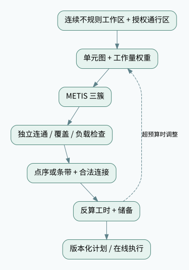

# 第 18 章 连通工作量分簇

用户要求的三个簇来自一个连续不规则工作区的算法划分。目标是把大任务变成三个时间可控、连通且可执行的子任务，而不是先画三个等面积方块。METIS 负责图上的划分，几何与车辆验证负责确认它是否能真正工作。


<!-- l02-figure-planning -->



## 从区域到图

将有效区域离散为单元，单元是图节点，共享可通行邻接关系是图边。节点权重表示预期工作量，例如点数量、停留时间、面积或近似条带时间。边权可表达切断相邻单元的代价。

图的连通不等于车辆可通行。两个格共享边，但狭窄处可能放不下整车；两个单元在拓扑上连通，连接姿态可能超出阿克曼曲率。因此建图前需要可通行几何，划分后仍需路径与足迹检查。

## METIS 的目标

多路图划分通常希望各簇权重接近目标，同时减少跨簇边。当前 C++ 后端调用 `METIS_PartGraphKway`，使用固定 seed、CONTIG、MINCONN 和不平衡参数。连续选项能帮助生成连通结果，但工程仍需独立遍历验证、检查空簇与面积覆盖。

均衡指标可写 `max(load_k)/(total/k)−1`。总权重 18、三个簇各 6 时为 0；若 9、5、4，则最大簇高出平均 50%。均衡很好也不代表都小于 1800 s，绝对预算和相对均衡需要同时满足。

## CSR 结构如何阅读

压缩稀疏行 CSR 用 xadj 表示每个节点的邻接起止，adjncy 保存邻居，vwgt 保存节点权重，adjwgt 保存边权。例如 xadj[i] 到 xadj[i+1] 的区间就是节点 i 的边。最后一个偏移应等于邻接数组长度。

C++ 使用 `idx_t` 匹配 METIS 的整数宽度，检查输入范围、对称边、重复边、正权重和总和溢出。`std::vector` 提供连续存储，`.data()` 把底层数组传给 C API。若 Python 输出浮点权重，需要先约定整数缩放，不能无意截断小工作量成零。

<!-- generated-production-start -->
## 固定生产代码逐段阅读

下面是固定提交中的原样节选。完整文件有离线行号页；片段可能省略上下文，不能单独当成可运行脚本。读完每段后，回到调用者确认它在当前任务中如何使用。

### partition_metis.cpp 第 25 至 66 行

[离线带行号源码](../../baseline/l02_views/87cb09ce9ea7-partition_metis.cpp.html#L25) · [固定 Git 提交](https://github.com/caihao1B/ROS2_BT-/blob/9aff8337b7794f704c5556a973a5220e73f17808/optimization_v2/ws/src/coverage_partition/src/partition_metis.cpp#L25)

```cpp
      std::cout<<json{{"metis",std::to_string(METIS_VER_MAJOR)+"."+std::to_string(METIS_VER_MINOR)+"."+std::to_string(METIS_VER_SUBMINOR)},
        {"idx_bits",8*sizeof(idx_t)},{"real_bits",8*sizeof(real_t)}}.dump()<<"\n";return 0;
    }
    require(argc==3,"USAGE input.json output.json"); std::ifstream f(argv[1]);require(f.good(),"NO_INPUT");json j;f>>j;
    auto x=integers(j.at("xadj")), a=integers(j.at("adjncy")), v=integers(j.at("vwgt")), w=integers(j.at("adjwgt"));
    require(j.at("k").is_number_integer() && j.at("seed").is_number_integer() && j.at("ufactor").is_number_integer(),"INTEGER_OPTIONS_REQUIRED");
    auto numbers=integers(json::array({j.at("k"),j.at("seed"),j.at("ufactor")}));
    idx_t n=static_cast<idx_t>(v.size()),k=numbers[0],seed=numbers[1],ufactor=numbers[2];
    require(n>=k && k>=2 && n<=10000 && a.size()<=100000,"GRAPH_SIZE");
    require(seed>=0 && ufactor>=1 && ufactor<=500,"OPTIONS");
    require(x.size()==static_cast<size_t>(n+1) && x.front()==0 && x.back()==static_cast<idx_t>(a.size()) && w.size()==a.size(),"CSR_SIZE");
    std::vector<std::map<idx_t,idx_t>> edges(n);int64_t total=0;
    for(idx_t i=0;i<n;i++) {
      require(v[i]>0 && x[i]<=x[i+1] && x[i+1]<=static_cast<idx_t>(a.size()),"BAD_WEIGHT_OR_OFFSET");total+=v[i];
      for(idx_t e=x[i];e<x[i+1];e++) {
        require(a[e]<n && a[e]!=i && w[e]>0,"BAD_EDGE");
        require(edges[i].emplace(a[e],w[e]).second,"DUPLICATE_EDGE");
      }
    }
    require(total<std::numeric_limits<idx_t>::max()/4,"WEIGHT_OVERFLOW");
    int64_t edge_total=0;
    for(idx_t i=0;i<n;i++) for(auto [b,weight]:edges[i]) {
      require(edges[b].count(i) && edges[b].at(i)==weight,"ASYMMETRIC_GRAPH");edge_total+=weight;
    }
    require(edge_total<std::numeric_limits<idx_t>::max()/4,"EDGE_WEIGHT_OVERFLOW");
    std::vector<bool> seen(n,false);std::queue<idx_t> q;q.push(0);seen[0]=true;idx_t reached=0;
    while(!q.empty()){auto i=q.front();q.pop();reached++;for(auto [b,weight]:edges[i])if(!seen[b]){seen[b]=true;q.push(b);}}
    require(reached==n,"DISCONNECTED_INPUT");
    idx_t opts[METIS_NOPTIONS];METIS_SetDefaultOptions(opts);
    opts[METIS_OPTION_NUMBERING]=0;opts[METIS_OPTION_SEED]=seed;
    opts[METIS_OPTION_OBJTYPE]=METIS_OBJTYPE_CUT;opts[METIS_OPTION_CONTIG]=1;
    opts[METIS_OPTION_MINCONN]=1;opts[METIS_OPTION_UFACTOR]=ufactor;
    opts[METIS_OPTION_NCUTS]=1;opts[METIS_OPTION_NITER]=20;
    idx_t ncon=1,cut=0;std::vector<idx_t> labels(n);
    int status=METIS_PartGraphKway(&n,&ncon,x.data(),a.data(),v.data(),nullptr,w.data(),&k,nullptr,nullptr,opts,&cut,labels.data());
    require(status==METIS_OK,"METIS_FAILED");std::vector<int> counts(k,0);
    for(auto c:labels){require(c>=0 && c<k,"BAD_LABEL");counts[c]++;}
    for(auto c:counts)require(c>0,"EMPTY_PART");
    json out={{"status","OK"},{"labels",labels},{"edge_cut",cut},{"counts",counts},{"seed",seed},{"contig",true},{"ufactor",ufactor}};
    std::ofstream o(argv[2]);require(o.good(),"NO_OUTPUT");o<<out.dump()<<"\n";std::cout<<"METIS_OK vertices="<<n<<" cut="<<cut<<"\n";return 0;
  }catch(const std::exception& e){std::cerr<<e.what()<<"\n";return 2;}
}
```

CSR 输入验证包括数组长度、整数范围、无重复对称边和输入连通。opts 设置 CONTIG、seed 与 UFACTOR，再调用真实 METIS。返回 labels 后检查每簇非空；车辆几何仍归 Python 后验。

### partition11.py 第 9 至 19 行

[离线带行号源码](../../baseline/l02_views/e654921ca2a1-partition11.py.html#L9) · [固定 Git 提交](https://github.com/caihao1B/ROS2_BT-/blob/9aff8337b7794f704c5556a973a5220e73f17808/optimization_v2/ws/src/coverage_partition/scripts/partition11.py#L9)

```python
def metis(g,k,seed,c,out):
    x=[0];a=[];ew=[]
    for neighbors in g['adj']:
        for j,w in sorted(neighbors.items()):a.append(j);ew.append(w)
        x.append(len(a))
    request=dict(xadj=x,adjncy=a,adjwgt=ew,vwgt=g['iw'].tolist(),k=k,seed=seed,ufactor=c['metis_ufactor'])
    dump(out/'csr.json',request)
    r=subprocess.run([str(BIN),str(out/'csr.json'),str(out/'metis.json')],capture_output=True,text=True,timeout=25)
    dump(out/'metis_command.json',dict(command=r.args,exit_code=r.returncode,stdout=r.stdout,stderr=r.stderr))
    if r.returncode:raise ValueError('METIS_REJECTED: '+r.stderr.strip())
    return np.array(read(out/'metis.json')['labels'],dtype=int)
```

Python 将 CSR 和整数权重序列化为 JSON，运行已构建后端并检查退出码。这个边界让 C++ 负责图算法、Python 负责几何与报告，输出文件不是自动可信输入。

<!-- generated-production-end -->

## Python 负责的几何验证

`geometry11.py` 构造几何单元和图，`partition11.py` 调后端、收集标签并进行后验检查。Shapely 处理多边形 union/intersection，NumPy 组织数组；C++ 后端并不知道每个单元的完整车体通行含义。

簇的形状可以不统一，也可以共享边界。簇边界是任务分工，不应该在同一个工作区中制造三个虚构障碍隔离带。条带最好在全工作区确定一致相位后再按簇归属裁剪，减少边界缝隙。

## 分簇与工时需要闭环

初始权重只是估计。生成点序或条带后，计算转弯、连接、倒车、点服务与储备时间；超预算则调整权重、分区或任务规模。不要只把节点权重凑到 1800 就宣布真实任务不会超时，动态等待和定位恢复都可能增加时间。

## 可运行练习

执行 `python3 examples/l02/labs.py 18`。它检查一个九节点线图的三个连通集合，显示负载均衡，并故意验证 [0,2] 不连通。它是划分结果验证器，不是 METIS 替代实现。生产代码的完整调用见本章摘录。

<!-- generated-lab-start -->
### 本章练习核心代码与实际输出

[完整教学脚本](../../examples/l02/labs.py) · [本章完整输出](../../validation/L02/lab_18.json)

代码只使用 Python 标准库；合成输入与历史记录在输出 kind 中区分。公共 ROOT、read、wrap、connected 等辅助函数在完整脚本中定义。

```python
def lab18():
    """Validate partition outputs; this small lab does not implement METIS."""
    edges={i:[j for j in [i-1,i+1] if 0<=j<9] for i in range(9)}
    weights=[1,1,4,2,2,2,3,1,2]
    labels=[0,0,0,1,1,1,2,2,2]
    clusters=[[i for i,x in enumerate(labels) if x==k] for k in range(3)]
    loads=[sum(weights[i] for i in c) for c in clusters]
    assert all(connected(c,edges) for c in clusters)
    assert not connected([0,2],edges)
    return dict(kind='synthetic checked partition',loads=loads,
                imbalance=max(loads)/(sum(loads)/3)-1,connected=True)
```

```text
{
  "chapter": "18",
  "passed": true,
  "result": {
    "kind": "synthetic checked partition",
    "loads": [
      6,
      6,
      6
    ],
    "imbalance": 0.0,
    "connected": true
  }
}
```

本章例子可以在 Windows 使用 `py -3` 或在 Linux 使用 `python3` 重跑。它验证局部概念或读取历史证据，不对机器人全任务提供新通过结论。
<!-- generated-lab-end -->

## 常见失败与自测

输入图不连通：先查永久障碍裁剪与邻接构造，不能把 CONTIG 当修复断图的魔法；空簇：检查有效单元数与权重；簇面积有洞或重叠：查几何并集与标签映射；工时不平衡：查转弯/停留成本是否进入权重；算法重跑形状改变：核查 seed、输入排序和库版本。

问：等面积是否适合点喷？答：如果点密度和停留时间不同，等面积不等工作量。问：路径经过另一个簇是否一定非法？答：取决于通行权限与任务组织，计账归属与物理通行边界应分别定义。

练习：给三个等面积区域加入不同数量的服务点，计算含每点三秒停留的工作量，再提出权重。能解释权重来源，比只展示彩色分区图更有说服力。
