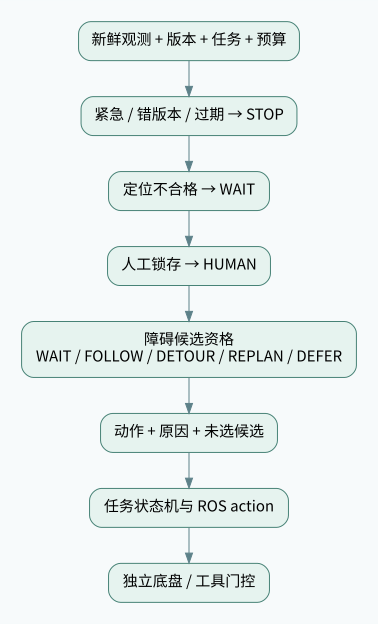

# 第 23 章 可解释行为树

行为树 BT 组织条件与动作，使高优先级状态能够反复检查。它不是自动生成最优策略的算法；可解释性来自明确的条件、优先级、阈值、原因码和输入证据。当前代码把这些一起输出，便于回答“为什么等待、为什么跟随、为什么不再重规划”。


<!-- l02-figure-bt -->



## 节点状态与组合

节点通常返回 SUCCESS、FAILURE、RUNNING。Sequence 按顺序执行，遇失败或运行中停止继续；Fallback 尝试候选，找到成功或运行中的分支停止。Reactive 组合每次 tick 重新检查前面的条件，适合让新的高优先级风险打断低优先级行为。

这里的 SUCCESS 是树节点的控制流结果，不一定是整项任务完成。当前简单动作节点调用 choose 写出一个决策就返回 SUCCESS，真正长任务由 Python mission 与 ROS action 执行。把两者混淆会误以为 BT 一次 tick 就完成了喷洒。

## 当前优先级

公共监督树依次检查紧急风险、版本、输入新鲜度、定位、停车储备、人工锁存、反馈完成、已验证替代路径和障碍交互，最后才执行下一义务。即使 complete 为真，紧急条件也优先停车。

人工锁存防止条件短暂恢复后自动启动。reset 需要车停、工具停、导航 idle、输入新鲜且无紧急/版本/定位问题。人工请求不意味着人必须立即接管驾驶；它首先要求停止并清楚说明剩余工作与原因。

## WAIT FOLLOW DETOUR REPLAN DEFER 的区别

WAIT 给短期障碍或清除迟滞留观察时间；FOLLOW 仅用于合格同向目标；DETOUR 要有当前验证过的足迹路径与足够预算；REPLAN 对持续阻塞发出新的全局查询；DEFER 在存在其它义务时保留原残余并改做别项。

持续时间、尝试次数和剩余预算限制恢复。达到界限进入 HUMAN。原因字段明确写着没有全局无路证明：本次有限搜索未得到合格路径，与“绝对不存在路径”是不同结论。

<!-- generated-production-start -->
## 固定生产代码逐段阅读

下面是固定提交中的原样节选。完整文件有离线行号页；片段可能省略上下文，不能单独当成可运行脚本。读完每段后，回到调用者确认它在当前任务中如何使用。

### common.xml 第 1 至 27 行

[离线带行号源码](../../baseline/l02_views/8e8146a17c41-common.xml.html#L1) · [固定 Git 提交](https://github.com/caihao1B/ROS2_BT-/blob/9aff8337b7794f704c5556a973a5220e73f17808/optimization_v2/ws/src/task_platform/r08_backend/common.xml#L1)

```xml
<root BTCPP_format="4" main_tree_to_execute="CommonSupervisor">
  <BehaviorTree ID="CommonSupervisor">
    <ReactiveFallback name="EvidencePrioritySupervisor">
      <Sequence name="ImmediateSafety"><Emergency/><EmergencyStop/></Sequence>
      <Sequence name="VersionContract"><WrongVersion/><VersionStop/></Sequence>
      <Sequence name="ObservationFreshness"><InputStale/><StaleStop/></Sequence>
      <Sequence name="LocalizationAdmission"><LocalizationMissing/><LocalizationWait/></Sequence>
      <Sequence name="ParkingReserve"><BudgetLow/><BudgetStop/></Sequence>
      <Sequence name="HumanInterventionLatch"><ManualHold/><ReportLatched/></Sequence>
      <Sequence name="FeedbackCompletion"><CompleteFeedback/><Complete/></Sequence>
      <Sequence name="ObservedReplannedMotion"><ActiveObservedPatch/><ExecuteObservedPatch/></Sequence>
      <Sequence name="ObstacleInteraction">
        <Blocked/>
        <ReactiveFallback name="BoundedObstacleOptions">
          <Sequence name="BoundedRetryLimit"><BlockExhausted/><ReportBlocked/></Sequence>
          <Sequence name="SameDirectionLeader"><LeaderSuitable/><FollowLeader/></Sequence>
          <Sequence name="WaitAndHysteresis"><ShortWait/><WaitClear/></Sequence>
          <Sequence name="CertifiedLocalAlternative"><ValidDetour/><UseDetour/></Sequence>
          <Sequence name="PersistentGlobalReplan"><CanReplan/><Replan/></Sequence>
          <Sequence name="OtherObligation"><CanDefer/><Defer/></Sequence>
          <WaitBounded/>
        </ReactiveFallback>
      </Sequence>
      <Execute name="TaskSpecificDispatcher"/>
    </ReactiveFallback>
  </BehaviorTree>
</root>
```

XML 的顺序就是优先级，ReactiveFallback 每次重新检查高优先级条件。末尾 Execute 只是写出任务选择，长动作由 mission 执行。节点 SUCCESS 不等于整个工作区完成。

### policy.hpp 第 18 至 49 行

[离线带行号源码](../../baseline/l02_views/0d9e211a9eb6-policy.hpp.html#L18) · [固定 Git 提交](https://github.com/caihao1B/ROS2_BT-/blob/9aff8337b7794f704c5556a973a5220e73f17808/optimization_v2/ws/src/task_platform/r08_backend/policy.hpp#L18)

```cpp
 void prepare(J context,double t){
  e=std::move(context);e["t"]=t;
  if(fresh()){
   if(yes("blocked")){if(blocked_since<0)blocked_since=t;clear_since=-1;}
   else {if(clear_since<0)clear_since=t;if(t-clear_since>=cfg.at("clear_hold_s").get<double>())blocked_since=-1;}
   if(leader())blocked_since=t; // Following is progress, not a persistent stationary obstruction.
   if(yes("commanded_motion")&&yes("localized")&&(!yes("blocked")||leader())){
    if(progress_since<0||num("progress_m")-last_progress>=cfg.at("progress_delta_m").get<double>()){progress_since=t;last_progress=num("progress_m");}
    if(t-progress_since>=cfg.at("progress_timeout_s").get<double>()){manual=true;manual_reason="MOTION_WITHOUT_OBSERVED_PROGRESS";}
   }else progress_since=-1;
  }
  d=J::object();
 }
 bool emergency()const{return yes("unsafe")||num("risk",0)>=1.||yes("collision");}
 bool version_bad()const{return !yes("bindings_valid");}
 bool localized_bad()const{return !yes("localized")||!yes("sensors_healthy");}
 bool budget_bad()const{return num("remaining_s")<=cfg.at("stop_reserve_s").get<double>()+num("next_min_s");}
 bool blocked()const{return yes("blocked")||blocked_since>=0;}
 bool leader()const{return yes("blocked")&&yes("leader_on_path")&&yes("leader_same_direction")&&num("leader_confidence")>=.75&&num("leader_speed")>.05&&num("clearance_m")>=cfg.at("follow_min_gap_m").get<double>()&&num("ttc_s",0)>=cfg.at("follow_min_ttc_s").get<double>()&&yes("path_valid");}
 bool short_wait()const{return duration()<cfg.at("short_wait_s").get<double>()||(!yes("blocked")&&blocked_since>=0);}
 bool detour()const{return yes("detour_valid")&&num("detour_s",1e6)+cfg.at("stop_reserve_s").get<double>()<num("remaining_s")&&num("detour_s",1e6)<cfg.at("persistent_block_s").get<double>()-duration();}
 bool replan()const{return duration()>=cfg.at("persistent_block_s").get<double>()&&num("replans")<cfg.at("max_replans").get<int>()&&num("remaining_s")>num("replan_s",10)+cfg.at("stop_reserve_s").get<double>();}
 bool defer()const{return duration()>=cfg.at("persistent_block_s").get<double>()&&yes("alternative")&&num("deferrals")<cfg.at("max_deferrals").get<int>();}
 bool exhausted()const{if(leader())return false;return duration()>=cfg.at("max_block_s").get<double>()||(duration()>=cfg.at("persistent_block_s").get<double>()&&!replan()&&!defer());}
 void choose(const std::string&action,const std::string&reason){
  double cap=cfg.at("speed_cap_mps");
  if(action=="FOLLOW")cap=std::max(0.,std::min(cap,num("leader_speed")+.35*(num("clearance_m")-cfg.at("follow_target_gap_m").get<double>())));
  if(action=="HUMAN"){manual=true;manual_reason=reason;}
  J alternatives=J::array({{{"action","WAIT"},{"eligible",!exhausted()},{"reason","bounded observation wait with clear hysteresis"}},{{"action","FOLLOW"},{"eligible",leader()},{"reason","same-direction tracked leader, clearance and TTC bounds"}},{{"action","DETOUR"},{"eligible",detour()},{"reason","only a validated live footprint path with sufficient budget"}},{{"action","REPLAN"},{"eligible",replan()},{"reason","persistent blockage and remaining planner attempts"}},{{"action","DEFER"},{"eligible",defer()},{"reason","another obligation exists; retain residual and original denominator"}}});
  for(auto& c:alternatives)c["selected"]=c["action"]==action;
  d={{"t",num("t")},{"action",action},{"reason_code",reason},{"speed_cap_mps",cap},{"blocked_duration_s",duration()},{"manual_latched",manual},{"evidence",e},{"thresholds",cfg},{"alternatives",alternatives},{"infeasibility_claim","No global no-path proof; bounded search results only"},{"work_credit",false}};
 }
```

prepare 维护阻塞和进展时间，leader/detour/replan/defer/exhausted 分别判断资格。choose 同时保存证据、阈值和所有候选资格，使日志能解释没有选中的原因。

<!-- generated-production-end -->

## 一个完整推理例子

假设定位有效、输入新鲜、剩余预算足够，路径上出现横穿目标。因为不同向，leader 不合格；阻塞刚开始，ShortWait 合格，所以 WAIT。几秒后若仍占用，且有已验证绕行且代价比继续等更有利，则 DETOUR；没有绕行时，达到持续门限且仍有次数/预算则 REPLAN；次数耗尽且没有可延期义务时 HUMAN。

这段说明是根据实际判据推演，不是宣称新增仿真全部观察到。现场应核对 decision 的 evidence、thresholds、alternatives 与 reason_code，确认哪个候选不合格。

## 进展监督的细节

仅发出非零命令不算进展，需要观测到沿任务的有效移动。代码在 commanded_motion、localized 且没有静态阻塞或属于合格跟随时计时，超时没有达到进展尺度就锁存 MOTION_WITHOUT_OBSERVED_PROGRESS。

跟随前车本身也是持续进展，不能把它一直算作静态阻塞而最终错误请求人工。反过来，前车停下后也不能永久享受 FOLLOW 特例，目标速度与新鲜度必须持续满足。

## C++ 注册与 XML

BehaviorTreeFactory 将字符串名称注册成条件或动作。XML 决定组合顺序，C++ 函数决定判据。改 XML 优先级会改变行为，即使所有条件函数原样保留；改函数阈值也会改变同一棵树的含义，因此两者都属于版本绑定。

JSON 的 `num()`、`yes()` 帮助拒绝错误类型和非有限值，默认值应保守。缺字段不能默认“安全”。不过只依赖默认值也可能掩盖上游 schema 错误，所以日志还要保留完整拒绝上下文。

## 练习与答案

执行 `python3 examples/l02/labs.py 23`。同一个 complete=True，在 unsafe=True 时返回 STOP，localized=False 时 WAIT。它只演示优先级，不复制完整生产树。

<!-- generated-lab-start -->
### 本章练习核心代码与实际输出

[完整教学脚本](../../examples/l02/labs.py) · [本章完整输出](../../validation/L02/lab_23.json)

代码只使用 Python 标准库；合成输入与历史记录在输出 kind 中区分。公共 ROOT、read、wrap、connected 等辅助函数在完整脚本中定义。

```python
def lab23():
    """Priority ordering illustration, not a replacement for BehaviorTree.CPP."""
    def decide(e):
        if e['unsafe']:return 'STOP'
        if not e['fresh']:return 'STOP'
        if not e['localized']:return 'WAIT'
        if e['manual']:return 'HUMAN'
        if e['complete']:return 'COMPLETE'
        return 'EXECUTE'
    normal=dict(unsafe=False,fresh=True,localized=True,manual=False,complete=True)
    unsafe={**normal,'unsafe':True};unlocalized={**normal,'localized':False}
    assert decide(unsafe)=='STOP' and decide(unlocalized)=='WAIT'
    return dict(complete=decide(normal),complete_but_unsafe=decide(unsafe),
                complete_but_unlocalized=decide(unlocalized))
```

```text
{
  "chapter": "23",
  "passed": true,
  "result": {
    "complete": "COMPLETE",
    "complete_but_unsafe": "STOP",
    "complete_but_unlocalized": "WAIT"
  }
}
```

本章例子可以在 Windows 使用 `py -3` 或在 Linux 使用 `python3` 重跑。它验证局部概念或读取历史证据，不对机器人全任务提供新通过结论。
<!-- generated-lab-end -->

问：BT 越深是否越高级？答：可解释性取决于责任、条件和证据，不取决于节点数量。问：为何要输出未选候选？答：它能区分“没有路径候选”“路径非法”“预算不足”，避免所有情况都只显示 replanning failed。

常见故障：WAIT/EXECUTE 抖动查迟滞与数据年龄；人工锁存莫名解除查 reset 条件；无限重规划查计数和预算；工具已开始却未响应 WAIT 查任务状态机，不只改 BT。

练习：给一次真实决策写三句话：触发输入是什么、选中分支为什么合格、最接近的另一个候选为什么不合格。不能只复述原因码名称。
