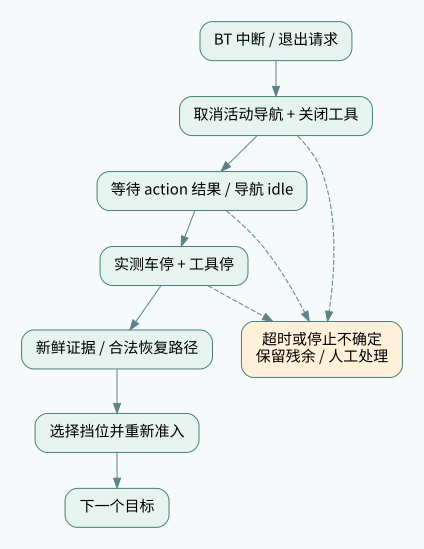

# 第 24 章 任务状态机与恢复

BT 决定应该做什么，状态机负责把异步动作可靠地做完或停止。长任务最容易出问题的地方往往不是正常路径，而是“刚发出目标就要取消”“工具启动中定位失效”“倒车结束还没停稳”这些交界。


<!-- l02-figure-cancel -->



## 显式阶段的价值

点喷经历导航、静止观测、必要的局部精停、服务、残余重试与结束。割草经历 READY、START_WORK、路径段执行、工具结束、换挡或恢复。阶段状态让收到同一 BT 指令时可以选择正确的收尾方式。

不能只写一个 `while not done`。循环必须持续处理消息，检查动作结果、BT、定位、预算、退出请求和物理反馈。等待函数同时限制仿真时间和墙钟，以防仿真暂停或数据不更新导致永远等待。

## START_WORK 期间也必须能中断

旧问题是割草在工具启动等待期间未充分响应 BT CANCEL/WAIT。当前 `begin_tool()` 发送 ToolTask 后，等待工具完成或真实工作反馈的同时调用 wait_startup；若发现中断，记录 BT_INTERRUPTS_START_WORK，调用 stop_all，再返回上层。

这修复了一个典型状态机漏洞：只在“正常行驶循环”检查安全决策，而在前置启动阶段忽略它。相同原则也适用于等待 action accepted、定位重验证、换挡和收尾。

<!-- generated-production-start -->
## 固定生产代码逐段阅读

下面是固定提交中的原样节选。完整文件有离线行号页；片段可能省略上下文，不能单独当成可运行脚本。读完每段后，回到调用者确认它在当前任务中如何使用。

### mission_mowing_r10.py 第 125 至 141 行

[离线带行号源码](../../baseline/l02_views/928bce3dd0f1-mission_mowing_r10.py.html#L125) · [固定 Git 提交](https://github.com/caihao1B/ROS2_BT-/blob/9aff8337b7794f704c5556a973a5220e73f17808/optimization_v2/ws/src/task_platform/scripts/mission_mowing_r10.py#L125)

```python
 def begin_tool(s):
  nonlocal active_tool,tool_future
  work_key,work_target=work_identity(s)
  g=ToolTask.Goal();g.operation=ToolTask.Goal.START_WORK;g.task_id='R09_'+cluster['cluster'];g.idempotency_key=cfg['version']+':'+work_key;g.segment_id=work_key;g.map_id=cfg['map_id'];g.map_revision=cfg['map_revision'];g.frame_epoch=cfg['frame_epoch'];g.plan_revision=cfg['version'];g.tool_revision=toolcfg['tool_revision'];g.target=pose(work_target);wire=np.asarray(s['target_area'],dtype=np.float32).astype(float);g.target_area.points=[Point32(x=float(x),y=float(y),z=0.) for x,y in wire];g.requested_quantity=float(abs(np.dot(wire[:,0],np.roll(wire[:,1],-1))-np.dot(wire[:,1],np.roll(wire[:,0],-1)))/2);g.timeout_sim_s=300.
  st['phase']='START_WORK';log('START_WORK_REQUEST',segment=s['id']);publish()
  active_tool=result(tool.send_goal_async(g),5)
  if not active_tool.accepted:active_tool=None;raise RuntimeError('TOOL_ACTION_REJECTED')
  tool_future=active_tool.get_result_async()
  interrupted=wait_startup(tick,lambda:st['t'],lambda:st['bt'],lambda:tool_future.done() or working_feedback_ready(st['tool'],st['t'],g.idempotency_key))
  if interrupted:
   log('BT_INTERRUPTS_START_WORK',action=(st['bt'] or {}).get('action'),reason=interrupted,segment=s['id']);stop_all();return False
  if tool_future.done():
   d=tool_finish_result()
   if d['state']=='SUCCEEDED':st['work_complete']=True;return True
   raise RuntimeError('TOOL_ADMISSION_FAILED')
  log('TOOL_WORKING_CONFIRMED',segment=s['id'],requested_area_m2=g.requested_quantity)
  return True
```

START_WORK 请求后保存活动句柄与结果 Future，wait_startup 在等待真实反馈时也检查 BT。中断进入 stop_all 并返回 False；只有有效成功或工作反馈才继续。

### recovery_mowing_r10.py 第 18 至 34 行

[离线带行号源码](../../baseline/l02_views/89c2a15110d3-recovery_mowing_r10.py.html#L18) · [固定 Git 提交](https://github.com/caihao1B/ROS2_BT-/blob/9aff8337b7794f704c5556a973a5220e73f17808/optimization_v2/ws/src/task_platform/scripts/recovery_mowing_r10.py#L18)

```python
def gear_runs(points):
    """Split at a sign change of motion along body heading; share the cusp pose."""
    runs=[];current=[];previous=0
    for a,b in zip(points,points[1:]):
        dx,dy=b[0]-a[0],b[1]-a[1]
        if math.hypot(dx,dy)<1e-7:continue
        heading=a[2]+.5*math.atan2(math.sin(b[2]-a[2]),math.cos(b[2]-a[2]))
        longitudinal=dx*math.cos(heading)+dy*math.sin(heading)
        if abs(longitudinal)<.9*math.hypot(dx,dy):raise ValueError('LATERAL_ACKERMANN_PATH')
        direction=1 if longitudinal>0 else -1
        if direction!=previous:
            if current:runs.append(dict(direction=previous,poses=current))
            current=[a];previous=direction
        current.append(b)
    if current:runs.append(dict(direction=previous,poses=current))
    if not runs:raise ValueError('NO_TRANSLATION')
    return runs
```

位移投影到中点航向得到挡位；明显侧向位移被拒绝。符号改变时结束旧 run 并共享尖点。这个函数只切路径，真正换挡还必须由门控确认车与工具停止。

<!-- generated-production-end -->

## 取消的三步握手

第一步申请取消，第二步确认 action 已终止或不再拥有控制，第三步确认车与工具实际停止。第二步成功后仍不能立即换挡或发新目标，因为执行器可能仍在减速。

`stop_all()` 同时处理导航和工具句柄，等待相应结果与实测停止。若反馈丢失，状态应保留不确定性，而不是写成 stopped=True。异常收尾也需要这些步骤，不能在 except 里只打印错误后直接退出。

## 恢复不能偷偷改变目标

阿克曼末端恢复需要到达原目标位姿，或按批准的安全版本保留原工作义务。`terminal_straight()` 生成末端切线直线只是候选，仍需包络与实时风险检查；retreat_prefix 也是工具关闭的候选，不能因它是“恢复动作”而免检。

`gear_runs()` 根据位移在车体航向上的符号分段，拒绝明显侧向移动；相邻段共享尖点。换挡时车和工具都停才允许切换。局部 cursor 只在附近前缀推进，防止折返路径空间上很近时跳到未来分支，虚增进展。

## 定位重验证与普通障碍恢复

定位失效意味着路径与当前位置关系需要重新确认，不能与普通绕障一概处理。停车收集证据、prepare/commit 新修正、验证任务版本与路径，再恢复。若新的 hold 在等待动作选择期间出现，也必须及时转入定位恢复，不能只检查进入等待时的旧状态。

每个恢复有次数、长度、时间和重新观测条件。使用同一失败连接无限重试会消耗全部仿真时间，且不能提供新证据。达到界限后保留残余、停车并报告人工，是合法终止方式。

## 离线握手练习

执行 `python3 examples/l02/labs.py 24`。取消请求、取消确认、实测停车、下一目标依次到来。观察 CANCEL_ACK 时 new_goal_allowed 仍为 false，只有停止确认后才变为 true。这是状态协议模型，不会真实取消任何 ROS 动作。

<!-- generated-lab-start -->
### 本章练习核心代码与实际输出

[完整教学脚本](../../examples/l02/labs.py) · [本章完整输出](../../validation/L02/lab_24.json)

代码只使用 Python 标准库；合成输入与历史记录在输出 kind 中区分。公共 ROOT、read、wrap、connected 等辅助函数在完整脚本中定义。

```python
def lab24():
    """Cancellation handshake prevents a new owner before old motion stops."""
    active=True;cancel_ack=False;stopped=False;states=[]
    for event in ['CANCEL_REQUEST','CANCEL_ACK','MEASURED_STOP','NEW_GOAL']:
        if event=='CANCEL_ACK':cancel_ack=True;active=False
        if event=='MEASURED_STOP':stopped=True
        allowed=(not active) and cancel_ack and stopped
        if event=='NEW_GOAL':assert allowed
        states.append(dict(event=event,new_goal_allowed=allowed))
    assert not states[1]['new_goal_allowed']
    return dict(kind='synthetic state machine',trace=states)
```

```text
{
  "chapter": "24",
  "passed": true,
  "result": {
    "kind": "synthetic state machine",
    "trace": [
      {
        "event": "CANCEL_REQUEST",
        "new_goal_allowed": false
      },
      {
        "event": "CANCEL_ACK",
        "new_goal_allowed": false
      },
      {
        "event": "MEASURED_STOP",
        "new_goal_allowed": true
      },
      {
        "event": "NEW_GOAL",
        "new_goal_allowed": true
      }
    ]
  }
}
```

本章例子可以在 Windows 使用 `py -3` 或在 Linux 使用 `python3` 重跑。它验证局部概念或读取历史证据，不对机器人全任务提供新通过结论。
<!-- generated-lab-end -->

## 现场怎样定位交界故障

从 mission_events 找最后一个阶段进入事件，再找对应请求、反馈、取消与结果。若有 START_WORK_REQUEST 却没有 TOOL_WORKING_CONFIRMED，查工具准入和 BT_INTERRUPTS_START_WORK；若取消已发但速度仍非零，查 gate、执行器与停车反馈；若恢复完成后立刻又 hold，查新证据时间屏障和版本。

问：把 Future.cancel() 调用成功当作机器人动作取消成功可以吗？答：本地 Future 的取消语义与 ROS action server 的目标取消不同，必须用正确 action 协议并确认执行结果。

练习：为“工具启动过程中感知丢失”写状态转换图，至少包含工具关闭、导航 idle、物理停止和残余保存。图中每条箭头应写条件，不写“过一会儿”。
