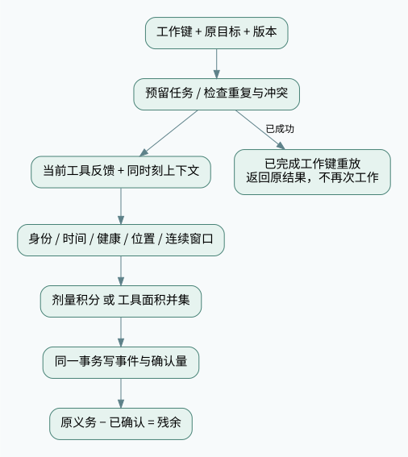

# 第 25 章 工具动作与有效作业账本

账本回答的不是“机器人计划做多少”，而是“哪些工作得到有效反馈确认”。这是项目从导航演示走向作业闭环的关键。当前工具为模拟抽象执行器，真实机械臂与切割结构留作后续项目，但请求、取消、反馈和幂等语义已经需要明确。


<!-- l02-figure-ledger -->



## Goal Result Feedback 三类信息

Goal 声明工作键、地图/计划/工具版本、目标位置或面积、请求量与超时；Feedback 提供阶段、确认量、健康与时间；Result 返回状态、错误、确认/剩余量、残余几何和不确定性。单位由工具合同决定，当前点喷的量不能未经标定就写成毫升。

工作请求被接受只代表预留任务。工具真正转动或有流量，也不自动意味着可记账：定位、目标、感知、速度、时间与反馈身份都必须满足条件。

## SQLite 的三张表

jobs 以工作键保存原目标指纹、状态、确认量、几何信用和不确定性；events 保存每条反馈是否接受及原因；transitions 保存状态变迁。SQLite 适合单机嵌入式可靠记录，Python 标准库即可访问，几何则用 Shapely/WKB。

`reserve()` 先比较 map_id、map_revision、frame_epoch、plan_revision、tool_revision，再检查能力和目标。相同 key 但目标内容不同会报 IDEMPOTENCY_CONFLICT；相同且已 SUCCEEDED 则返回 replayed，不再次执行。

## 幂等和残余重试

幂等指重复请求同一已确认操作不会重复产生效果。它需要稳定工作身份，也需要对目标内容做指纹检查。每次重试都随机换工作键，会绕开去重；复用旧键却改变请求区域，则应拒绝。

失败但停止已确认时，可以按原工作键补剩余量。停止不确定时不能直接重试，因为工具可能在通信丢失后继续工作。进程重启把原 RUNNING 任务标为 RECOVERY_REQUIRED 和 uncertain，要求恢复确认，而不是自动从零开始。

<!-- generated-production-start -->
## 固定生产代码逐段阅读

下面是固定提交中的原样节选。完整文件有离线行号页；片段可能省略上下文，不能单独当成可运行脚本。读完每段后，回到调用者确认它在当前任务中如何使用。

### ledger_core.py 第 33 至 53 行

[离线带行号源码](../../baseline/l02_views/29a5c7cd7b61-ledger_core.py.html#L33) · [固定 Git 提交](https://github.com/caihao1B/ROS2_BT-/blob/9aff8337b7794f704c5556a973a5220e73f17808/optimization_v2/ws/src/work_ledger/scripts/ledger_core.py#L33)

```python
 def reserve(self,g,attempt,now=0.):
  for k in ['map_id','map_revision','frame_epoch','plan_revision','tool_revision']:
   if g.get(k)!=self.c.get(k):return dict(ok=False,error='VERSION_'+k)
  if g.get('operation') not in [1,2] or not g.get('idempotency_key') or not g.get('task_id'):return dict(ok=False,error='INVALID_GOAL')
  if (g['operation']==1)!=(self.c['vehicle']=='diff'):return dict(ok=False,error='CAPABILITY')
  if g.get('frame')!='map' or not all(math.isfinite(x) for x in [*g['target'],g['requested_quantity'],g['timeout_sim_s']]) or not 0<g['timeout_sim_s']<=300 or g['requested_quantity']<=0:return dict(ok=False,error='GOAL_RANGE')
  if g['operation']==2:
   p=Polygon(g['area'])
   if not p.is_valid or p.area<.01 or g['requested_quantity']>p.area+1e-6:return dict(ok=False,error='TARGET_AREA')
  key=g['idempotency_key'];fp=canonical(g);r=self.db.execute('SELECT fingerprint,status,uncertain FROM jobs WHERE key=?',(key,)).fetchone()
  if r and r[0]!=fp:return dict(ok=False,error='IDEMPOTENCY_CONFLICT')
  if r and r[1]=='SUCCEEDED':return dict(self.snapshot(key),replayed=True)
  if r and (r[2] or r[1]=='RECOVERY_REQUIRED'):return dict(ok=False,error='RECOVERY_REQUIRED',**{k:v for k,v in self.snapshot(key).items() if k!='ok'})
  if self.active:return dict(ok=False,error='BUSY')
  self.db.execute('BEGIN IMMEDIATE')
  try:
   if not r:self.db.execute('INSERT INTO jobs(key,fingerprint,goal,status,attempt) VALUES(?,?,?,?,?)',(key,fp,json.dumps(g),'RUNNING',attempt))
   else:self.db.execute("UPDATE jobs SET status='RUNNING',attempt=?,reason='' WHERE key=?",(attempt,key))
   self.db.execute('INSERT INTO transitions(key,t,status,reason) VALUES(?,?,?,?)',(key,now,'RUNNING','RESERVED_NOT_COMPLETED'));self.db.execute('COMMIT')
  except BaseException:self.db.execute('ROLLBACK');raise
  self.active=key;self.previous=None;self.streak=None;return dict(self.snapshot(key),replayed=False)
```

reserve 检查版本、能力与目标，工作键查重后比较目标指纹。SUCCEEDED 返回 replayed，uncertain 拒绝自动重试；BEGIN IMMEDIATE 将任务预留与状态变迁原子提交。

### ledger_core.py 第 69 至 100 行

[离线带行号源码](../../baseline/l02_views/29a5c7cd7b61-ledger_core.py.html#L69) · [固定 Git 提交](https://github.com/caihao1B/ROS2_BT-/blob/9aff8337b7794f704c5556a973a5220e73f17808/optimization_v2/ws/src/work_ledger/scripts/ledger_core.py#L69)

```python
 def observe(self,m,ctx,now):
  if not self.active:return dict(accepted=False,reason='NO_ACTIVE_JOB')
  key=self.active;g=self.goal(key);snap=self.snapshot(key,geometry=False);reason='OK';t=m.get('t',-100);seq=m.get('seq',-1);epoch=m.get('sensor_epoch','');identity=epoch+':'+str(seq)+':'+m.get('attempt','')
  if self.db.execute('SELECT 1 FROM events WHERE id=?',(identity,)).fetchone():return dict(accepted=False,reason='DUPLICATE')
  if m.get('key')!=key or m.get('attempt')!=snap['attempt']:return dict(accepted=False,reason='WRONG_ATTEMPT')
  if m.get('tool_revision')!=g['tool_revision'] or epoch!=self.c['session']:reason='VERSION'
  elif not math.isfinite(t) or not -1e-6<=now-t<=self.c['feedback_age_sim_s']:reason='TIMESTAMP'
  elif seq<=self.last_seq.get(epoch,-1):reason='SEQUENCE'
  elif not ctx or abs(ctx['t']-t)>self.c['pose_skew_s']:reason='POSE_SKEW'
  else:reason=self.guard(ctx,g,now)
  self.last_seq[epoch]=max(seq,self.last_seq.get(epoch,-1))
  if reason=='OK' and not all(math.isfinite(m.get(k,float('nan'))) for k in ['rpm_rad_s','flow']):reason='NONFINITE_FEEDBACK'
  if reason=='OK' and (not m.get('healthy') or not m.get('request_on') or abs(m.get('rpm_rad_s',0))<self.c['working_min_rad_s']):reason='TOOL_NOT_WORKING'
  prev=self.previous;dt=t-prev['t'] if prev else 0
  if reason=='OK':
   if prev is None or dt<=0 or dt>self.c['feedback_gap_s']:self.streak=t;reason='FIRST_OR_GAP'
   elif self.streak is None:self.streak=t;reason='CONFIRMING'
   elif t-self.streak<self.c['working_confirm_sim_s']:reason='CONFIRMING'
  else:self.streak=None
  q=snap['confirmed_quantity'];blob=self.db.execute('SELECT credit FROM jobs WHERE key=?',(key,)).fetchone()[0];credit=wkb.loads(blob) if blob else Polygon()
  if reason=='OK':
   if g['operation']==1:q+=max(0,min(1.,m.get('flow',0),prev.get('flow',0)))*dt
   else:
    erosion=self.c['pose_erosion_m']+math.hypot(.35,.45)*self.c['yaw_erosion_rad'];precision=self.c['ledger_precision_m'];p=footprint(*ctx['tool_xy'],ctx['yaw'],.70,self.c['tool']['virtual_effective_width_m'],erosion+precision).intersection(Polygon(g['area']).buffer(-precision));credit=union(credit,set_precision(p,precision),grid_size=precision);q=credit.area
  self.db.execute('BEGIN IMMEDIATE')
  try:
   self.db.execute('INSERT INTO events VALUES(?,?,?,?,?,?,?,?)',(identity,key,snap['attempt'],t,int(reason=='OK'),reason,q,json.dumps(dict(feedback=m,context=ctx))))
   self.db.execute('UPDATE jobs SET quantity=?,credit=?,updated=? WHERE key=?',(q,wkb.dumps(credit),now,key));self.db.execute('COMMIT')
  except BaseException:self.db.execute('ROLLBACK');raise
  self.previous=m if reason in ['OK','FIRST_OR_GAP','CONFIRMING'] else None
  self.rejected[reason]=self.rejected.get(reason,0)+1
  return dict(accepted=reason=='OK',reason=reason,quantity=q)
```

observe 按事件身份去重，检查时间、上下文、序号与工具健康，再按连续反馈积剂量或几何面积。事件和工作量在同一事务写入；失败也记录 reason，便于解释为什么没有信用。

<!-- generated-production-end -->

## 有效反馈怎样积分

反馈身份由 epoch、sequence 与 attempt 等组成，重复事件直接拒绝。时间必须新鲜、单调，与作业上下文匹配；工具要健康、请求开启且转速足够；连续有效窗口满足后才开始记量。

点喷按有效 flow 与 dt 累积，并限制异常值；割草把工具足迹与目标区域相交，再对历史信用取并集，面积作为确认量。定位不确定性通过收缩与几何精度策略影响信用，不能把计划路径缓冲区全部当已完成面积。

两个关键边界是首次样本与反馈断档。单个新样本没有前一时刻支撑 dt，不应凭空积分一段；长断档不能按整段时间假设工具一直正常。重新连续确认后再计量，这会保守保留残余。

## 事务与持久化

`BEGIN IMMEDIATE` 开始写事务，写事件和更新工作量一起提交；异常时 ROLLBACK，避免只写了一半。WAL 提供写前日志模式，synchronous=FULL 增强提交持久性，busy_timeout 允许短暂等待锁。

它们不能解决所有业务问题：如果上游把错误姿态标成有效，数据库会忠实保存错误信用。因此数据库事务保障存储一致性，传感器与几何门控保障业务意义，两者缺一不可。

## 真实三点案例的证据

样章中第二点工具 JAM 导致失败，停止确认后按残余重试；另一次已完成工作键重放前后计量值都是 3.2337，说明该次重放没有新增工具效果。三点最终完成，不代表原 56 点全部完成，也不代表真实喷头剂量标定已经完成。

## 可运行的最小账本

执行 `python3 examples/l02/labs.py 25`。内存 SQLite 表用 event 主键去重，第一次确认 1.2，重复同一事件仍为 1.2，新增另一反馈后为 2.0。参数化 SQL 用 `?` 传值，避免字符串拼接与转义错误。

<!-- generated-lab-start -->
### 本章练习核心代码与实际输出

[完整教学脚本](../../examples/l02/labs.py) · [本章完整输出](../../validation/L02/lab_25.json)

代码只使用 Python 标准库；合成输入与历史记录在输出 kind 中区分。公共 ROOT、read、wrap、connected 等辅助函数在完整脚本中定义。

```python
def lab25():
    """In-memory SQLite unique event key avoids duplicate credit."""
    db=sqlite3.connect(':memory:')
    db.execute('CREATE TABLE confirmed(event TEXT PRIMARY KEY, amount REAL NOT NULL)')
    def confirm(event,amount):
        with db:db.execute('INSERT OR IGNORE INTO confirmed VALUES (?,?)',(event,amount))
        return db.execute('SELECT COALESCE(SUM(amount),0) FROM confirmed').fetchone()[0]
    first=confirm('job1:sample1',1.2);replay=confirm('job1:sample1',1.2);last=confirm('job1:sample2',.8)
    assert first==replay and last==2.
    db.close()
    return dict(kind='teaching transaction, production has richer feedback checks',
                first=first,replay=replay,after_new_feedback=last)
```

```text
{
  "chapter": "25",
  "passed": true,
  "result": {
    "kind": "teaching transaction, production has richer feedback checks",
    "first": 1.2,
    "replay": 1.2,
    "after_new_feedback": 2.0
  }
}
```

本章例子可以在 Windows 使用 `py -3` 或在 Linux 使用 `python3` 重跑。它验证局部概念或读取历史证据，不对机器人全任务提供新通过结论。
<!-- generated-lab-end -->

这个例子只说明事务与去重，不实现生产中的时间、健康、几何、版本和不确定性门控。生产逻辑必须阅读 `Ledger.reserve/guard/observe` 及当前任务派生适配，不能直接把两列表用于真实工具。

## 常见问题与自测

重复记账查事件身份与工作键；面积增长过快查是否取并集、工具偏移与连接段；重启后拒绝工作查 RECOVERY_REQUIRED；账本锁住查是否有另一写者或未结束事务；反馈已有但量不增长查 FIRST_OR_GAP、CONFIRMING 和拒绝原因。

问：删除账本再跑是否解决重复请求冲突？答：会丢掉已确认事实，可能导致重复作业。应确认目标版本和身份，保留原记录并执行明确恢复。

练习：写出“工作完成但 result 丢失”后的安全处理步骤。正确思路是查询稳定工作键与账本状态，而不是立即再次执行完整剂量。
